<!-- SPDX-License-Identifier: CC-BY-4.0 -->
# QCD.ComplexAtlas.001 — Complex lattices, finite fields, and Julia countermodels

**Executed research:** thirteen exact lattice families, four finite quadratic
rings, ordinary and twisted cochain checks, and four noncanonical polynomial
escape-time portraits. Gaussian and Eisenstein **raw** maps, residue-wise
quotient maps, finite-ring affine maps, and holomorphic maps are explicitly
separate objects.

[Exact Go atlas](go/ComplexAtlas.go) · [Independent tests](go/ComplexAtlas_test.go) ·
[Polynomial Lean proofs](lean/ComplexPolynomials.lean) ·
[Finite fields and Galois proofs](lean/ComplexFields.lean) ·
[Detailed mathematics](tex/ComplexAtlas.tex) · [Source audit](ResearchAudit.md) ·
[Executed verification](Verification.md) · [Machine-readable census](other/AtlasData.json)

## The principal mathematical finding

For odd real integral $c$, every nonreal raw $(3,c,2)$ lattice seed escapes
in full sequence: its nonzero second coefficient loses its finitely many
factors of two, then grows exactly by $3$ at every tick.
[The descent is proved in writing and Lean](../QCD.ComplexLattice.001/README.md).
Thus the raw $(3,-1,2)$ maps studied here cannot have nonreal recurrent
basins. Apparent lattice textures are not automatically Julia sets.

The four-residue quotient map is different:

$$
J_\pm(z)=
\begin{cases}
z/2,&r(z)=0,\\
(3z\pm r(z))/2,&r(z)\ne0.
\end{cases}
\qquad r(z)=(x\bmod2)+(y\bmod2)\theta.
$$

It has genuine nonreal cycles, including the plus two-cycle
$1+\theta\to2+2\theta\to1+\theta$. The Gaussian plus convention is the
Joseph map in Kucinski [Kucinski00]. Neither its cycles nor a conjecture about
its long-run behavior may be transferred to the fixed-offset raw convention.

## Exact lattice atlas

Every family tests all $97^2=9,409$ coefficient seeds $(x,y)\in[-48,48]^2$,
for at most $256$ ticks. An integer coordinate fence of $2^{26}$ prevents
overflow. The total is $122,317$ seeds, not an infinite-family experiment.
For $\theta=i$, the plotting coordinates are $(x,y)$; for
$\theta=\omega$, they are $(x-y/2,\sqrt3y/2)$.

| Family | Ring | Convention | $(q,c,d)$ or residue parameters | Exact-cycle seeds | Coordinate exits | Unresolved prefixes |
|---|---|---|---|---:|---:|---:|
| GaussianPlus | $\mathbb Z[i]$ | raw | $(3,1,2)$ | 97 | 0 | 0 |
| GaussianMinus | $\mathbb Z[i]$ | raw | $(3,-1,2)$ | 97 | 0 | 0 |
| EisensteinPlus | $\mathbb Z[\omega]$ | raw | $(3,1,2)$ | 97 | 0 | 0 |
| EisensteinMinus | $\mathbb Z[\omega]$ | raw | $(3,-1,2)$ | 97 | 0 | 0 |
| GaussianRamified | $\mathbb Z[i]$ | raw | $(2,1,1+i)$ | 13 | 9,396 | 0 |
| GaussianRotated | $\mathbb Z[i]$ | raw | $(2i,1+i,2)$ | 1 | 9,408 | 0 |
| EisensteinRotated | $\mathbb Z[\omega]$ | raw | $(2\omega,1,2)$ | 1 | 9,408 | 0 |
| EisensteinRamified | $\mathbb Z[\omega]$ | raw | $(1-\omega,1,1-\omega)$ | 8 | 9,401 | 0 |
| GaussianSplit | $\mathbb Z[i]$ | raw | $(2+i,0,2-i)$ | 1 | 9,408 | 0 |
| GaussianJosephPlus | $\mathbb Z[i]$ | residue quotient | $J_+$ | 745 | 8,510 | 154 |
| GaussianJosephMinus | $\mathbb Z[i]$ | residue quotient | $J_-$ | 745 | 8,510 | 154 |
| EisensteinResiduePlus | $\mathbb Z[\omega]$ | residue quotient | $J_+$ | 745 | 8,510 | 154 |
| EisensteinResidueMinus | $\mathbb Z[\omega]$ | residue quotient | $J_-$ | 745 | 8,510 | 154 |

Each of the first four rows additionally contains **9,312 proved off-axis
escapes**. Each quotient row finds 45 distinct cycles reached from this seed
window, not all cycles of the infinite map. The two signs are conjugate by
$z\mapsto-z$ on the symmetric window. Gaussian/Eisenstein coordinate rules
are identical for scalar parameters, but their physical lattice embeddings
differ; repeated counts are not independent evidence for convergence.

**Lattice legend:** navy = the checked off-axis escape theorem applies;
orange = a coordinate fence was crossed, **not** a general escape proof;
gray = unresolved at the horizon. Other colors identify exact reached cycles
by a stable six-color hash. Several different cycles can share a color:
use the census's marked representative and period for identification.
A filled cell represents one integer-basis seed, not all continuous points
inside a square or parallelogram.

### Raw $(3,-1,2)$ in the two complex lattices

| Gaussian | Eisenstein |
|---|---|
| 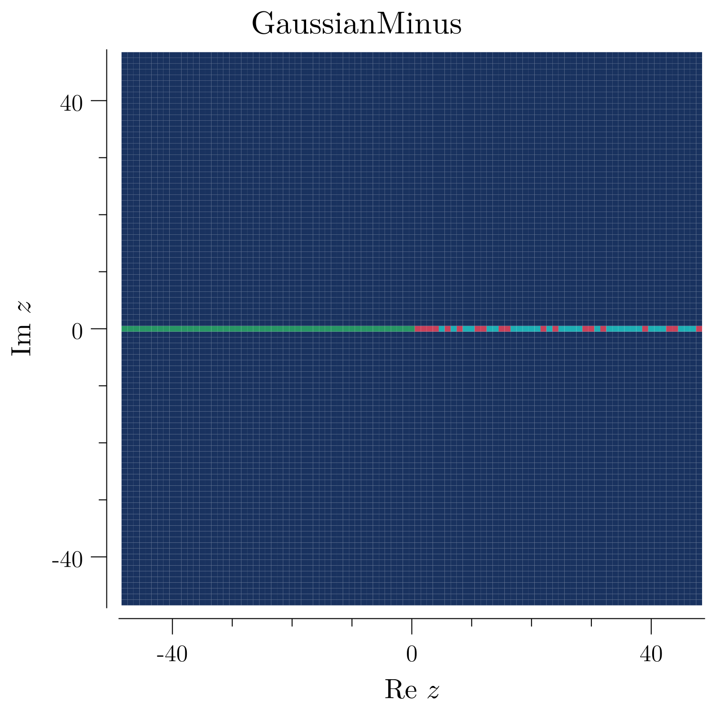 | 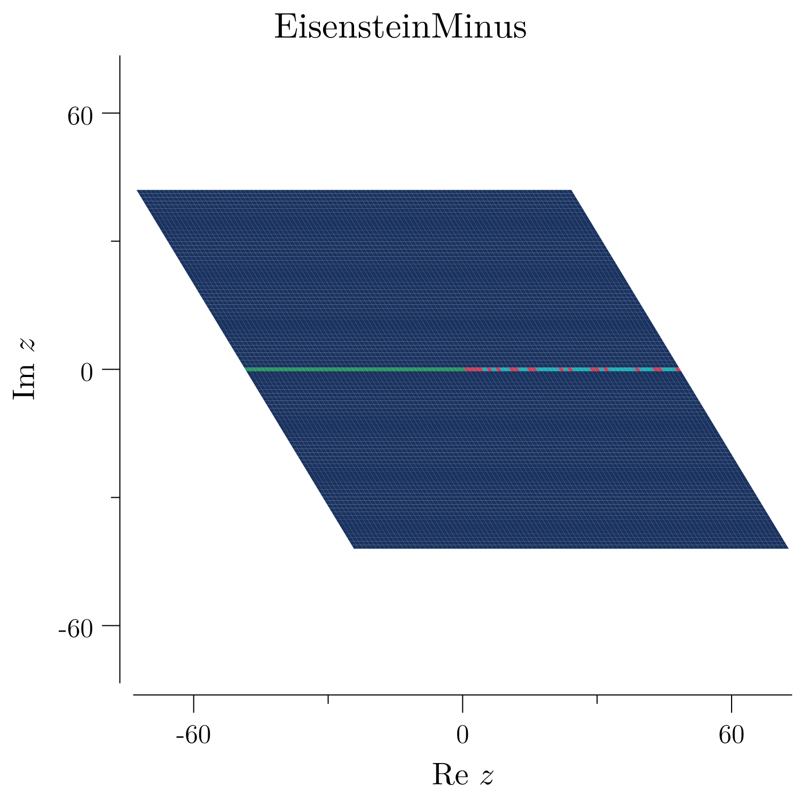 |

### Residue-wise quotient $(3,\pm r,2)$

| Gaussian plus (Joseph convention) | Eisenstein minus extension |
|---|---|
| 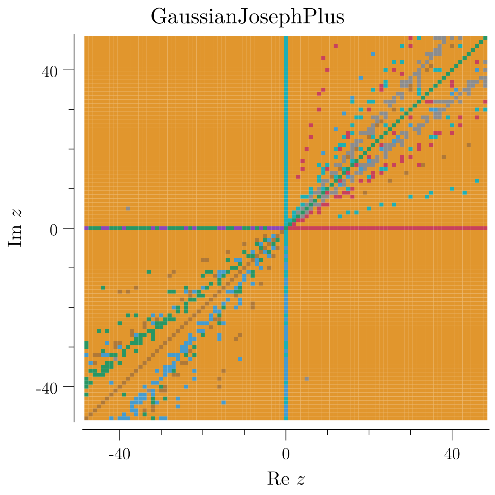 | 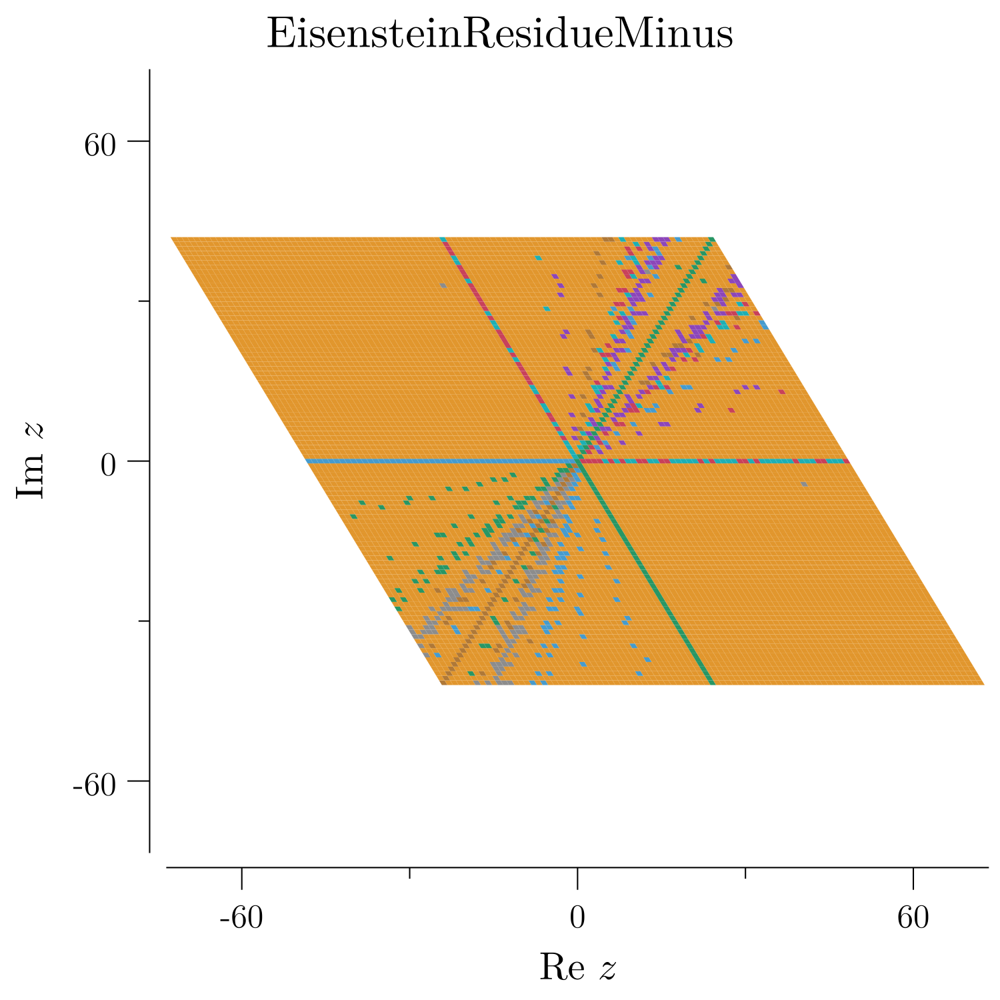 |

### Genuinely complex parameters and prime splitting

| Gaussian ramified divisor $1+i$ | Eisenstein rotated multiplier $2\omega$ |
|---|---|
| 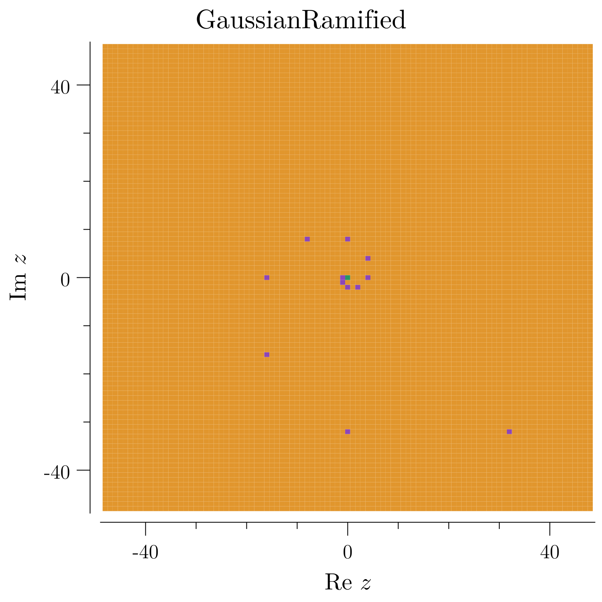 | 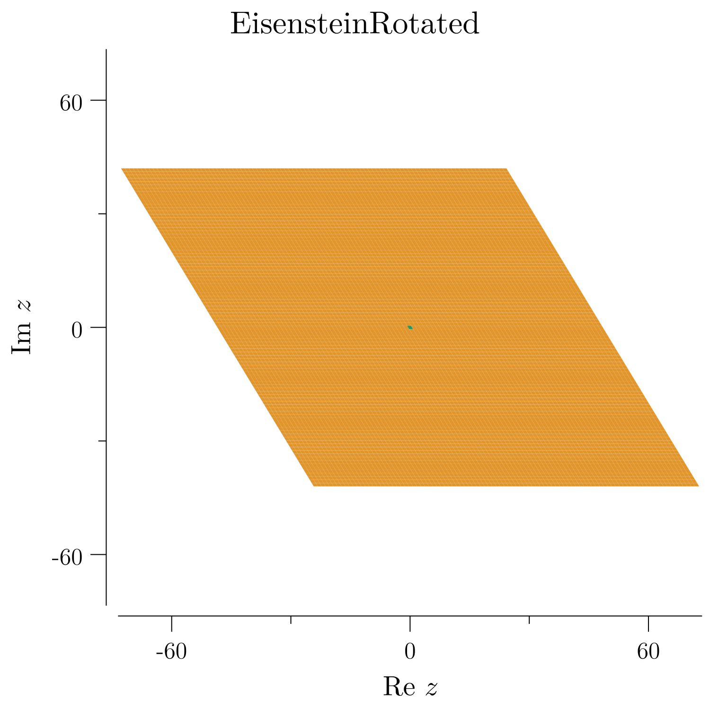 |

[Gaussian plus](other/GaussianPlus.png) · [Eisenstein plus](other/EisensteinPlus.png) ·
[Gaussian rotated](other/GaussianRotated.png) ·
[Eisenstein ramified](other/EisensteinRamified.png) ·
[Gaussian split pair](other/GaussianSplit.png) ·
[Gaussian quotient minus](other/GaussianJosephMinus.png) ·
[Eisenstein quotient plus](other/EisensteinResiduePlus.png)

## Cohomology with concrete coefficient fields

[Cycle cochains and holonomy](../QCD.ComplexCohomology.001/README.md) computes
$H^1\cong K$ on an ordinary nonempty cycle, regardless of length. For a
rank-one affine local system with linear holonomy $P$ and weighted offset $B$,

$$
H^1_\lambda=0\quad(P\ne1),\qquad
H^1_\lambda\cong K\quad(P=1),\qquad
(1-P)z_0=B.
$$

The lattice ring and the cochain field are separate parameters. The exact
census of $z\mapsto\theta z+1$ on Gaussian/Eisenstein quotients distinguishes
$\mathbb F_9$, $\mathbb F_4$, and the two ramified nonfields. Incidence ranks
are checked over $\mathbb F_2,\mathbb F_3,\mathbb F_5$. All nonzero-multiplier
words of lengths one through three over those three fields are exhausted
against direct potential enumeration. No raw halving map is silently reduced
modulo a field of characteristic two.

### Actual quadratic Galois fields, with ramified negative controls

These are actual field structures in Lean, not a relabelling of
$\mathbb Z/9\mathbb Z$ or $\mathbb Z/4\mathbb Z$:

$$
K_9=\mathbb F_3[\bar i],\quad\bar i^2=-1,
\qquad K_4=\mathbb F_2[\bar\omega],\quad\bar\omega^2+\bar\omega+1=0.
$$

Their defining polynomials have no roots in the coefficient fields. The
quadratic field construction therefore applies. Directly,

$$
\sigma_9(x+y\bar i)=x-y\bar i=(x+y\bar i)^3,
\qquad
\sigma_4(x+y\bar\omega)=(x+y)+y\bar\omega=(x+y\bar\omega)^2.
$$

Each nonidentity automorphism squares to identity, and its fixed points are
exactly those with $y=0$. Every coefficient-field algebra automorphism is
identity or this Frobenius: it must send the generator to one of the two
roots of its defining polynomial, and that image determines the automorphism.
Thus both quadratic Galois groups have exactly two elements. These statements,
cardinalities, root choices and nontriviality are checked in
[`ComplexFields.lean`](lean/ComplexFields.lean).

The exact Go census exhausts the full tiny rings, including all possible
inverses and Frobenius images:

| State ring | States | Frobenius images | Fixed elements | Defining-polynomial roots in the ring | Invertible nonzero elements |
|---|---:|---:|---:|---:|---:|
| Gaussian modulo $2$, ramified | 4 | 2 | 2 | 2 | 2 |
| Gaussian modulo $3$, $K_9$ | 9 | 9 | 3 | 2 | 8 |
| Eisenstein modulo $2$, $K_4$ | 4 | 4 | 2 | 2 | 3 |
| Eisenstein modulo $3$, ramified | 9 | 3 | 3 | 3 | 6 |

In the nonfields, $1+\bar i$ modulo $2$ and $1-\bar\omega$ modulo $3$
are nonzero with square zero. Frobenius is not injective there. These are
formal and computational negative controls against calling every quadratic
quotient a Galois field.

**Concrete use, not decorative terminology:** conjugation transports the
whole finite affine orbit at the same clock, with *both* parameters changed:

$$
\sigma(T_{q,c}^{\circ j}(z))=
T_{\sigma(q),\sigma(c)}^{\circ j}(\sigma(z)),\qquad T_{q,c}(z)=qz+c.
$$

The checked `ConjugationAffineOrbit` and $\sigma^2=1$ give both reconstruction
directions. In particular $c=1$ stays fixed and conjugate multipliers have
isomorphic marked cycle graphs and the same incidence ranks. This is an
executable finite-model symmetry; it is not a descent proof for an infinite
lattice map or a reason to ignore its branch guards.

## Julia portraits: same lattice cycle, different complex stability

For a polynomial $p$, its filled Julia set is
$K_p=\{z:\sup_n|p^{\circ n}(z)|<\infty\}$, and its Julia set is
$J_p=\partial K_p$. These are genuine holomorphic dynamics, but the four
chosen polynomials below preserve only the stated finite raw orbit nodes.
They are **not extensions of the raw map on the entire integer or complex
lattice**. `FiniteAgreementOnly` proves their failure already at the seed $3$.

For the raw minus cycle $1\to2\to1$ and fixed point $0$, choose

$$
p_-(z)=-\frac32z^2+\frac72z,
\qquad
\widetilde p_-(z)=\frac12z^3-3z^2+\frac92z.
$$

For the raw plus cycle $1\to4\to2\to1$ and $0$, choose

$$
p_+(z)=\frac76z^3-7z^2+\frac{59}6z,
\qquad
\widetilde p_+(z)=\frac29z^4-\frac7{18}z^3-\frac{35}9z^2+\frac{145}{18}z.
$$

The cycle multiplier is the product of complex derivatives at its nodes.
Exact Lean calculations give

| Preserved raw cycle | Minimal model multiplier | Perturbed model multiplier |
|---|---:|---:|
| Minus two-cycle | $-5/4$ (repelling) | $0$ (superattracting) |
| Plus three-cycle | $1475/54$ (repelling) | $0$ (superattracting) |

The perturbations vanish at the specified nodes, but change derivatives.
This is a **refuted transfer route**: finite orbit values do not determine
complex stability or basin geometry. A Julia portrait of a chosen
interpolation is not an invariant of the raw Collatz family.

### Minus two-cycle models

| Repelling preserved cycle | Superattracting preserved cycle |
|---|---|
| 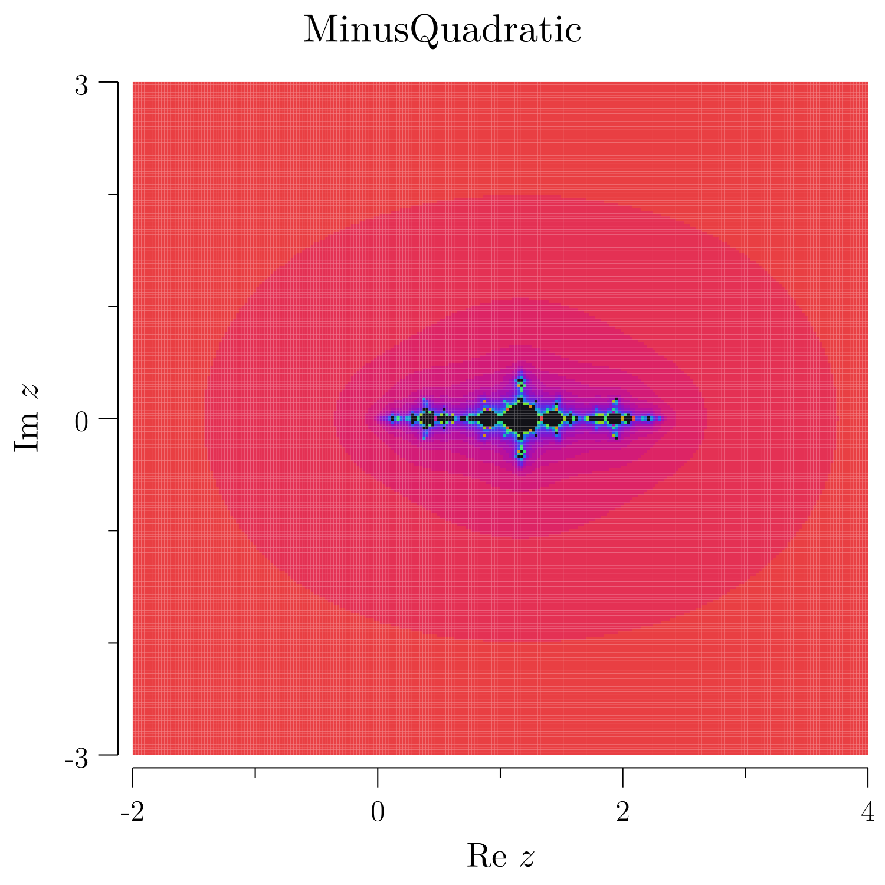 | 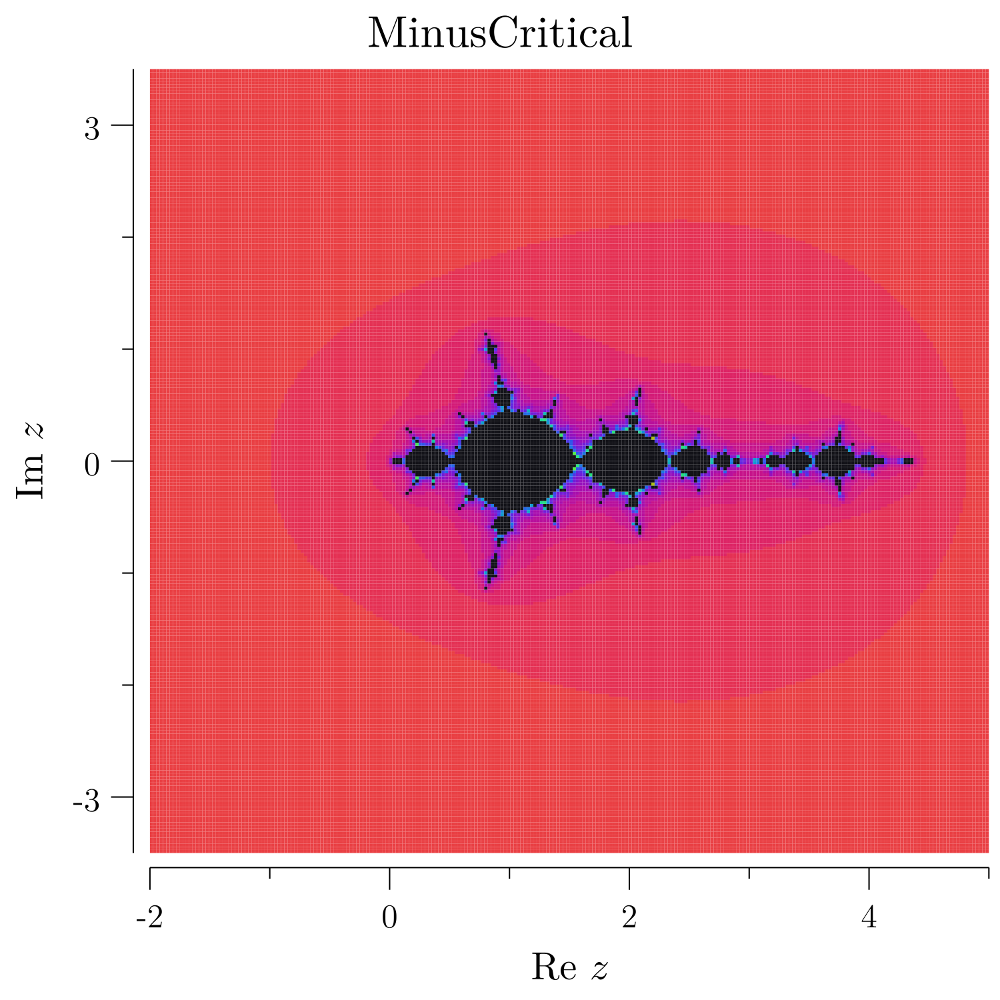 |

### Plus three-cycle models

| Repelling preserved cycle | Superattracting preserved cycle |
|---|---|
| 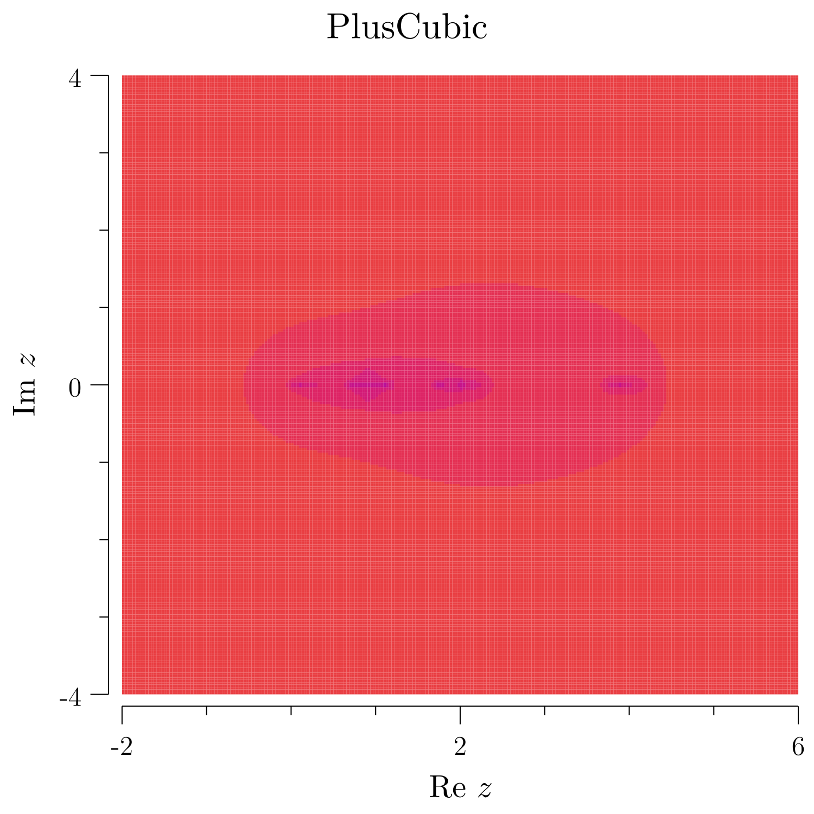 | 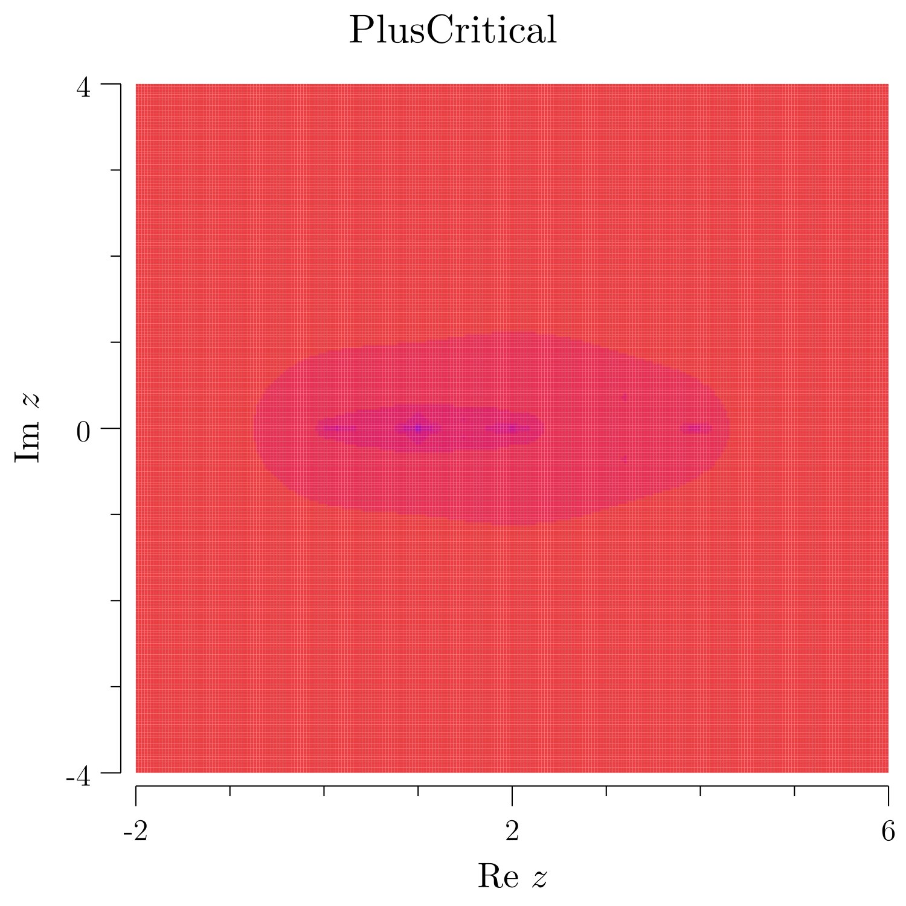 |

### Resolving the small plus-cycle basin

The global plus panels do not visibly resolve the small superattracting
basin. These additional views use the **same coefficients**, not new models,
on $[0.994,1.006]+i[-0.006,0.006]$ around the common cycle point $1$:

| Repelling plus model, zoom | Superattracting plus model, zoom |
|---|---|
| 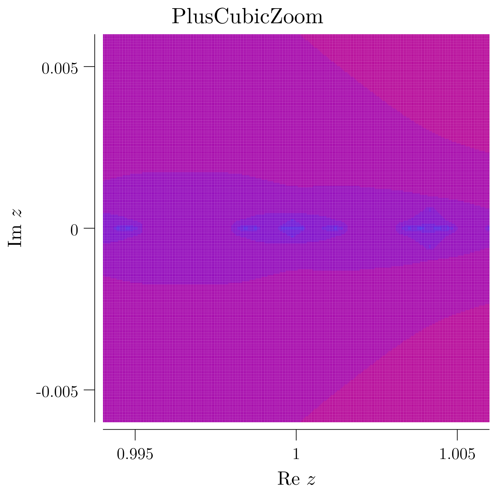 | 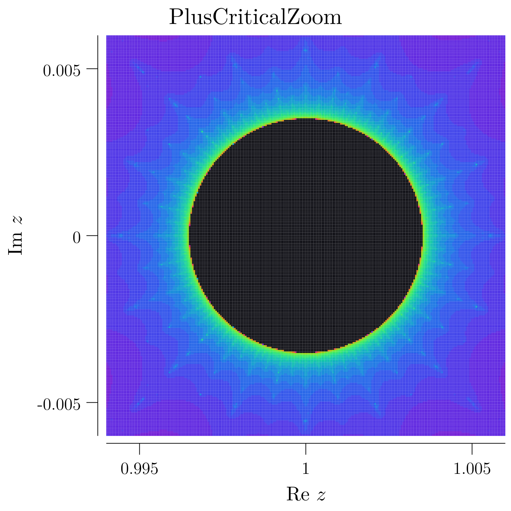 |

A fixed-mesh visibility test confirms zero finite-horizon survivors in the
repelling zoom and a nonempty dark region in the critical zoom. This is a
numerical contrast, not a certified basin boundary. Explicit decimal ticks
keep $0.995$, $1$ and $1.005$ distinguishable. The JSON records every view's
coefficients, box, horizon and numerical survivor count.

**Numerical legend:** colors encode the first tick with $|z|>8$; dark means
only that the sample survived 128 ticks. The mesh is $256\times256$ sample
centers in each declared box. Four global views and two zooms of the same four
models give $393,216$ samples in total. These are finite-time floating-point
escape portraits, not interval-certified Julia membership or a
Hausdorff-dimension calculation.

**Exact radius certificate:** all four models satisfy

$$
|z|\ge8\quad\Longrightarrow\quad|p(z)|\ge2|z|,
\qquad |p^{\circ j}(z)|\ge2^j|z|.
$$

The written and Lean proofs justify the mathematical escape radius for exact
orbits. Horner iteration in `complex128` still has roundoff; that theorem
does not certify every numerical pixel near a boundary.

## Reproduction and visual quality

```bash
export PATH="$HOME/.local/go/bin:$HOME/.elan/bin:$PATH"
make lean
CGO_ENABLED=0 go test -v ./QCD.ComplexAtlas.001/go
make go GOFILE=QCD.ComplexAtlas.001/go/ComplexAtlas.go
make tex TEXFILE=QCD.ComplexAtlas.001/tex/ComplexAtlas.tex
bash Scripts/CheckIgnoredPdfs.sh
bash Scripts/CheckIgnoredTexTemps.sh
```

The run produces 19 vector PDFs, 19 tracked GitHub-visible PNG previews and
`AtlasData.json`. Each preview is 1500×1500 at 300 dpi for a 5in×5in square.
Latin Modern outlines use consistent measurement and drawing; titles are
16pt, axes 14pt, ticks 12pt. PDFs remain ignored. The label renderer recognizes
exactly the ten expressions documented in `LabelText`; it is not a general
TeX parser. GitHub pages use dollar-delimited math and linked PNGs rather than
assuming that TeX sources or ignored PDFs render inline.

## Current boundary of the research

Established: off-axis raw escape for every odd real offset; explicit
nonreal quotient cycles; field-guard collapse; computed finite-field/ring
cohomology; exact finite-node polynomial countermodels and escape radii.
Open: raw real-axis universal targets, other complex raw families, exhaustive
infinite Joseph/Eisenstein cycle classification, and any justified
Julia-to-arithmetic transfer. The next informative test is an admissible
branch-word census with integral recovery and retained cycle marks—not
unmarked cohomology or visual resemblance alone.
