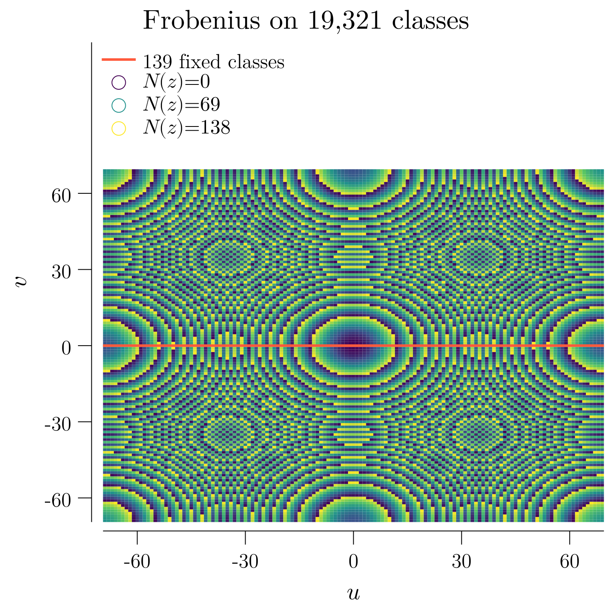
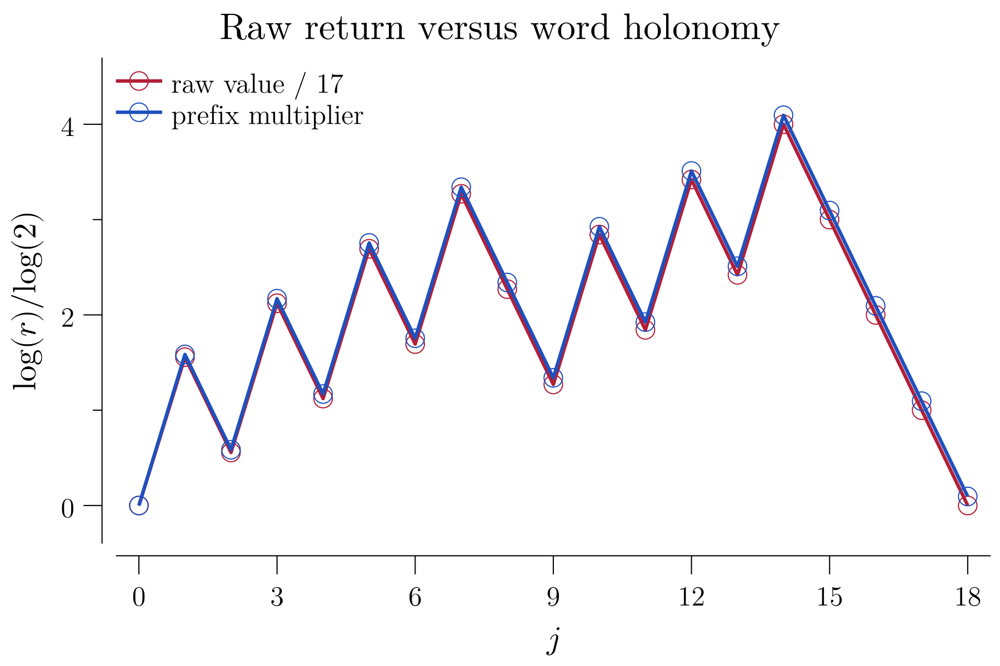
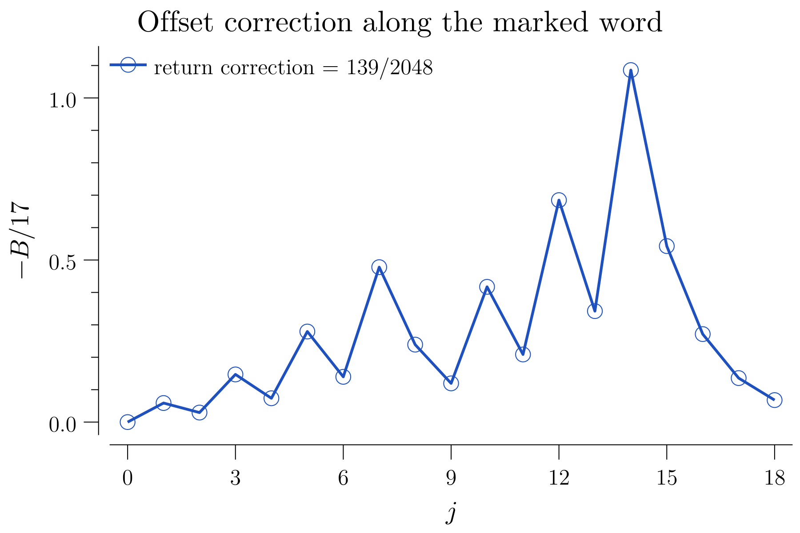

<!-- SPDX-License-Identifier: CC-BY-4.0 -->
# A marked cycle, characteristic 139, and an actual Galois action

**Closed obligations:** a legal integer cycle at its original raw clock;
its characteristic-sensitive twisted cochain quotient; an actual Gaussian
extension field; and Frobenius descent to that quotient, with an explicit
fixed-class bijection.

[Lean proofs](lean/CycleResonance.lean) ·
[Independent finite certificate](go/CycleResonance.go) ·
[Negative controls](go/CycleResonance_test.go) ·
[Detailed proofs](tex/CycleResonance.tex) ·
[Integral cycle arithmetic](CycleArithmetic.md)

## Keep states, coefficients, and clocks separate

The state map remains the original integer raw rule:

```math
T(x)=
\begin{cases}
x/2,&2\mid x,\\ 3x-1,&2\nmid x,
\end{cases}
\qquad x\in\mathbb Z.
```

Its marked cycle is

```math
\begin{aligned}
17&\to50\to25\to74\to37\to110\to55\to164\to82\\ &\to41\to122\to61\to182\to91\to272\to136\to68\to34\to17.
\end{aligned}
```

All eighteen interior states are distinct. There are seven affine ticks and
eleven division ticks. `RawEdges`, `RawCycleOrbit`, `RawCycleReturn` and
`RawCycleMinimal` check the actual foundational map, every iterate, and
the exact raw period. This is not a seven-tick raw cycle.

Coefficient reduction does **not** reduce the integer branch guard. The inputs
$`0`$ and $`139`$ represent the same class modulo
$`139`$, but their raw successors represent different classes.
Thus there is no raw quotient map on this residue field.

## The computed quotient changes with characteristic

Let the affine edge positions be
$`J=\{0,2,4,6,9,11,13\}`$. Over a coefficient field in which
$`2\ne0`$, set

```math
\lambda_j=
\begin{cases}3,&j\in J,\\1/2,&j\notin J,\end{cases}
\qquad
(\delta_\lambda f)_j=f_{j+1}-\lambda_jf_j,
\qquad f_{18}=f_0.
```

The cohomology is the **actual quotient**
$`H^1_\lambda=K^{18}/\operatorname{im}\delta_\lambda`$,
not a renamed scalar defect. Its holonomy is

```math
P=\frac{3^7}{2^{11}}=\frac{2187}{2048},
\qquad
P=1\iff139=0\text{ in }K.
```

The existing ordered transport proof recovers a common periodic potential
from one scalar closing equation. When $`P\ne1`$,
every cochain is exact. When $`P=1`$, the weighted period

```math
\Pi_\lambda(a)=
\sum_{j=0}^{17}\left(\prod_{k=j+1}^{17}\lambda_k\right)a_j
```

induces an explicit linear isomorphism from the quotient to the coefficient field.

| Coefficient field | Holonomy | Incidence rank | Dimension of the actual quotient |
|---|---:|---:|---:|
| $`\mathbb C`$ | $`2187/2048\ne1`$ | 18 | 0 |
| $`\mathbb F_{137}`$ | 79 | 18 | 0 |
| $`\mathbb F_{139}`$ | 1 | 17 | 1 |
| $`\mathbb F_{139^2}`$ | 1 | 17 over the extension field | 1 over the extension field |

These statements follow from the proved quotient isomorphism or
nonneutral surjectivity, not merely a finite matrix experiment.
Characteristics $`2,3`$ are rejected by the finite local-system
certificate: respectively halving is undefined or an affine multiplier is zero.

### A nonzero quotient is not a nonzero dynamical offset

The actual edge offset is $`-1`$ on affine ticks and
$`0`$ on division ticks. The cast cycle vertices form a
**single common periodic potential**, so

```math
a=\delta_\lambda v,\qquad[a]=0.
```

This remains true at resonance. Over $`\mathbb F_{139}`$,
the actual weighted period is zero; a cochain equal to one on the last edge
and zero elsewhere instead has period one and represents a nonzero class.

Over the nonresonant control field, the actual weighted period is
$`44`$, yet the offset remains exact. Away from neutrality,
period zero is **not** the coboundary criterion.

## A genuine Gaussian extension and complete automorphism group

Construct

```math
E=\mathbb F_{139}[i],\qquad i^2=-1.
```

The no-root check covers every base-field coefficient, so this is a field,
not a ramified quadratic ring. Its unique coefficient pairs give
$`139^2=19321`$ elements. The extension is Galois, and

```math
\sigma(u+vi)=(u+vi)^{139}=u-vi,\qquad
\operatorname{Gal}(E/\mathbb F_{139})=\{1,\sigma\},\qquad \sigma^2=1.
```

The Lean classification proves **every** base-algebra automorphism is one of
these two; it does not infer exhaustion from exhibiting conjugation.
The only defining-polynomial roots are $`i,-i`$,
and the Frobenius-fixed elements are exactly the prime subfield.

## The action descends on the same cohomology classes

Conjugate every edge coordinate. The weights are fixed by the base-field
automorphism, and conjugation preserves the genuine coboundary subspace.
Thus it induces $`\overline{\Sigma}`$ on the actual quotient.
For the checked period isomorphism $`\Phi:H^1_\lambda(E)\to E`$,

```math
\Phi(\overline\Sigma x)=\sigma(\Phi(x)),
\qquad
\overline\Sigma^2x=x,
\qquad
\overline\Sigma x=x\iff\operatorname{Im}_i\Phi(x)=0.
```

The fixed classes are explicitly in bijection with
$`\mathbb F_{139}`$: send a fixed class to the real
coefficient of its period, and recover it using the inverse period isomorphism.
There are exactly **139 fixed classes**. No enumeration of all
$`19321^{18}`$ edge representatives is used.

The action is **semilinear**, not extension-field linear:
$`\overline{\Sigma}(i x)=-i\,\overline{\Sigma}(x)`$.
`SigmaH1NotLinear` gives an explicit counterexample to the latter claim.

This is a Galois action on graph cohomology. It is not a construction of
group Galois cohomology, étale cohomology, or an arithmetic detector for every family.

## Fixed/sign recovery and finite pictures

The full quotient has **19,321 classes** by the same period isomorphism.
For $`z=\Phi(x)=u+vi`$, define the two classes using that already constructed inverse:

```math
x_+=\Phi^{-1}(u),\qquad x_-=\Phi^{-1}(vi),\qquad
x=x_++x_-,\qquad
\overline\Sigma x_+=x_+,\quad \overline\Sigma x_-=-x_-.
```

This is unique: a fixed class has zero imaginary period coefficient, and a
sign-reversed class has zero real period coefficient. Their sum determines both
coordinates. `GaloisDecomposition` and `GaloisDecompositionUnique`
prove recovery on the actual classes. This is not an assertion of extension-field
linear eigenspaces: Frobenius is only prime-field linear.



Every cell depicts the class whose period is the chosen representative
$`u+vi`$, with $`u,v\in[-69,69]`$ reduced modulo 139.
Frobenius reflects across $`v=0`$; the red line represents its 139 fixed classes.
Color records the exact prime-field norm

```math
N(u+vi)=(u+vi)(u-vi)=u^2+v^2\pmod{139}.
```

All 19,321 norm identities and their Frobenius invariance are independently
checked in Go; `Gaussian139Norm` proves the displayed identity in Lean.
Purple through yellow orders **chosen integer representatives** of the norm.
It is not a canonical metric or topology on the finite field, a complex Julia set,
or a fractal-dimension calculation. The uncolored strip only houses the legend.




At prefix length $`j`$, write $`v_j=P_j\,17+B_j`$.
The first plot compares $`\log_2(v_j/17)`$ with $`\log_2P_j`$.
The second isolates $`-B_j/17=P_j-v_j/17`$ so the small endpoint
difference is visible. The actual return has $`v_{18}/17=1`$ while
$`P_{18}=2187/2048`$ and $`-B_{18}/17=139/2048`$.
These floating-point logarithmic/rational coordinates are illustrations of
the finite exact identities, not stability claims for a neighborhood.

The three PDFs are vector output, kept ignored. GitHub previews are 300-dpi PNGs:
1500 by 1500 for the finite-field panel and 1800 by 1200 for the two 3:2 profiles.
Latin Modern outlines use identical measurement and drawing metrics; title,
axis, tick and scatter sizes are explicitly 16 pt, 14 pt, 12 pt and 4 pt.
The renderer accepts exactly the eight labels used here, **not arbitrary TeX**.

## Reproduction and exact remaining scope

```bash
make lean
CGO_ENABLED=0 go test -count=1 ./QCD.ComplexCohomology.001/go
make go GOFILE=QCD.ComplexCohomology.001/go/CycleResonance.go
make tex TEXFILE=QCD.ComplexCohomology.001/tex/CycleResonance.tex
bash Scripts/CheckIgnoredPdfs.sh
bash Scripts/CheckIgnoredTexTemps.sh
```

The Go census checks all 19,321 coefficient pairs, including all 19,320
nonzero inverses, all Frobenius images, the 139 fixed coefficients, the two roots,
and all 19,321 norm identities. It writes `other/CycleResonance.json` and the three figures.
Tests separately replay the raw edges, exact prime-field ranks, common-potential
offset identity, invalid coefficients and the nonresonant control.

**Preserved:** original integer legality and raw clock, edge order, common witnesses,
actual quotient and coefficient-field action. **Not settled:** other integer cycles,
infinite-graph cohomology, integer-wide holomorphic interpolation, a Julia-to-lattice
transfer, source-corpus migration, or universal Collatz convergence.
