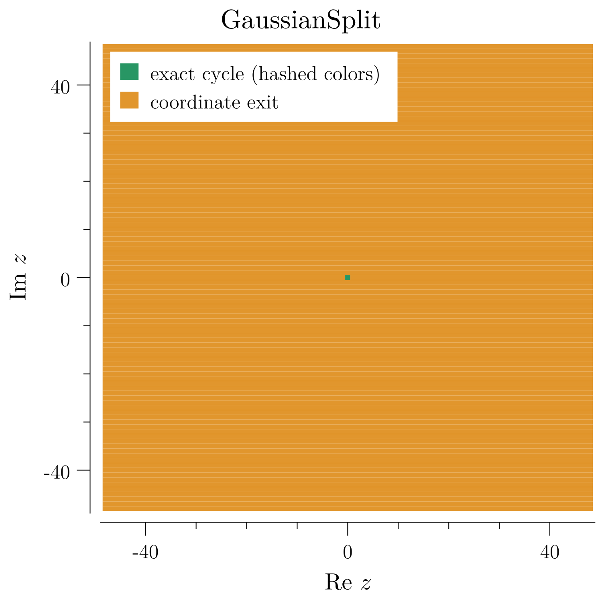

<!-- SPDX-License-Identifier: CC-BY-4.0 -->
# QCD.GaussianDynamics.001 — Exact Gaussian division and homogeneous escape

**Checked theorems:** exact Gaussian divisibility, a terminating division
prefix with an integral height budget, and full-sequence homogeneous escape
under an explicit Bézout identity. Equal parameter norms do not imply a
common power or a neutral orbit.

[Lean proofs](lean/GaussianDynamics.lean) ·
[Detailed proofs](tex/GaussianDynamics.tex) ·
[Related lattice survey](../QCD.ComplexDynamics.001/README.md) ·
[Related literature](../QCD.ComplexDynamics.001/Literature.md)

## Domain and exact branch

Work in $`R=\mathbb Z[i]`$, not the field $`\mathbb C`$. Put
$`N(x+iy)=x^2+y^2`$ and, for a nonzero Gaussian divisor $`d`$,

```math
T(z)=\begin{cases}z/d,&d\mid z\text{ in }R,\\qz+c,&d\nmid z\text{ in }R.\end{cases}
```

The division branch is used only when its quotient lies in $`R`$; zero divides
to zero. Writing $`d=s+it`$ and $`z=x+iy`$, the guard is exactly

```math
(s^2+t^2)\mid sx+ty,
\qquad (s^2+t^2)\mid sy-tx.
```

**Proof.** The inverse multiplication matrix gives
$`z/d=((sx+ty)+i(sy-tx))/(s^2+t^2)`$. Its denominator is nonzero because
$`d\ne0`$. Thus both divisibilities are necessary and sufficient for an
integral Gaussian quotient. This is `DvdCoordinates` in Lean.

## Division prefix and its budget

Assume $`N(d)\ge2`$ and $`z\ne0`$. There are $`r\ge0`$ and $`t\in R`$ such that

```math
z=d^rt,\qquad d\nmid t,\qquad T^r(z)=t,\qquad 2^r\le N(z).
```

This prefix applies for any $`q,c`$: no affine event occurs before $`t`$.

**Proof.** For a legal division, $`z=d(z/d)`$ and multiplicativity gives
$`N(z)=N(d)N(z/d)`$. The quotient is nonzero. Consequently its positive
integral height strictly decreases. Strong induction on $`N(z)`$ ends at a
nondivisible $`t`$ and reconstructs all $`r`$ division ticks and the factorization.
Finally $`N(z)=N(d)^rN(t)\ge2^r`$ because $`N(t)\ge1`$. The exact integer budget
is checked by `DivisionPrefixBudget`; no floating-point logarithm or
uniform computational efficiency claim is needed.

## Bézout avoidance and full-sequence escape

Assume $`c=0`$, $`N(q),N(d)\ge2`$, and supply $`a,b\in R`$ with

```math
aq+bd=1.
```

Every nonzero seed escapes in full sequence. After its division prefix,

```math
T^{r+j}(z)=q^jt,\qquad N(T^{r+j}(z))=N(q)^jN(t)\ge2^j.
```

**Proof.** If $`d\mid qt`$, multiplying the Bézout identity by $`t`$ gives
$`t=a(qt)+b(dt)`$, so $`d\mid t`$, a contradiction. Apply the same argument
inductively to $`q^jt`$. Every subsequent guard therefore chooses the affine
branch; there are no hidden future divisions. The exact norm formula proves
that for every bound $`B`$ there is a raw time $`K`$ after which **every** norm
exceeds $`B`$. A valid coarse choice is $`K=r+B+1`$, using $`k<2^k`$.
This is `CoprimeHomogeneousEscape`.

The supplied identity is stronger than merely asserting that no common
nonunit element divides $`q,d`$ in a general order. The
[quadratic-order counterexample](../QCD.QuadraticArithmetic.001/README.md)
explains why that distinction is necessary.

## Equal norms, different ideals

Choose $`q=2+i`$, $`d=2-i`$, and $`c=0`$. Then $`N(q)=N(d)=5`$, but

```math
-q+(1+i)d=1.
```

The escape theorem applies to every $`z\ne0`$. Zero is fixed.
Moreover, $`q^a\ne d^b`$ for all positive integers $`a,b`$.

**Proof of the power obstruction.** The ring homomorphism
$`R\to\mathbb F_5`$ sending $`i\mapsto2`$ is valid because $`2^2+1=0`$ modulo
$`5`$. It sends $`q\mapsto4`$, a unit, and $`d\mapsto0`$. Positive powers of
$`d`$ map to zero, whereas powers of $`q`$ remain units. Equality is impossible.
The formal results are `EqualNormSplitEscape` and `EqualNormNoCommonPower`.



This bounded picture is not the proof: its coordinate exits are separately
labelled in the survey. The theorem above supplies the universal conclusion
for this particular homogeneous family.

## Reduction contract and remaining obligations

- **Original obligation:** determine the full tail of every nonzero homogeneous
  Gaussian orbit under the stated Bézout and norm hypotheses.
- **Replacement obligations:** remove the finite exact-division prefix, prove
  guard avoidance, and evaluate a single geometric-power tail.
- **Recovery:** the same seed, Gaussian elements, branch legality and original
  raw clock are retained; the prefix and every tail state are reconstructed.
- **Demonstrated gain:** the positive integral height decreases at every
  unresolved prefix step, with $`2^r\le N(z)`$. All remaining guards are then
  eliminated by a proved invariant, not a guessed norm balance.
- **Preservation conditions:** $`z\ne0`$, $`N(q),N(d)\ge2`$, $`c=0`$, and a common
  supplied Bézout identity. Unit divisors, offsets, and noncoprime parameters
  are not silently included.
- **Open:** classification outside these hypotheses and any Julia-to-lattice
  correspondence. No positive-integer Collatz convergence theorem follows.

```bash
export PATH="$HOME/.elan/bin:$HOME/.local/go/bin:$PATH"
lake build GaussianDynamics
make tex TEXFILE=QCD.GaussianDynamics.001/tex/GaussianDynamics.tex
bash Scripts/CheckIgnoredPdfs.sh
bash Scripts/CheckIgnoredTexTemps.sh
```
