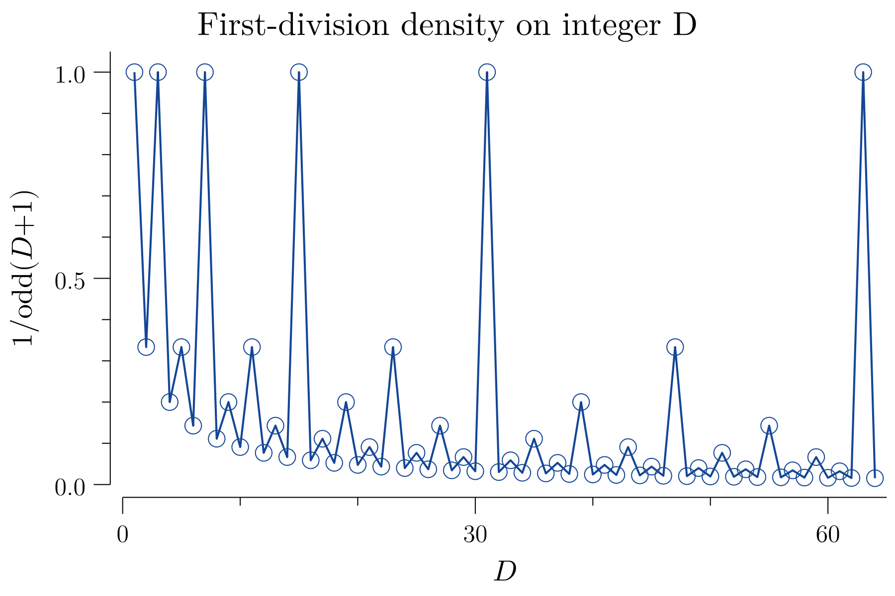
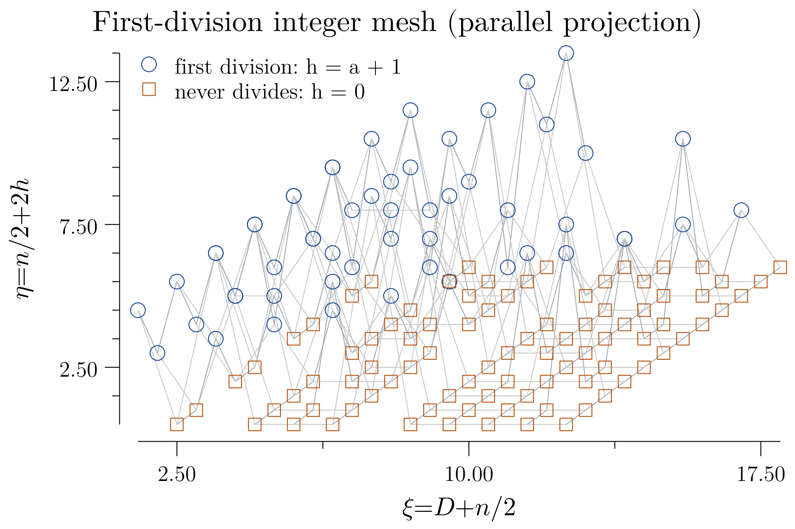
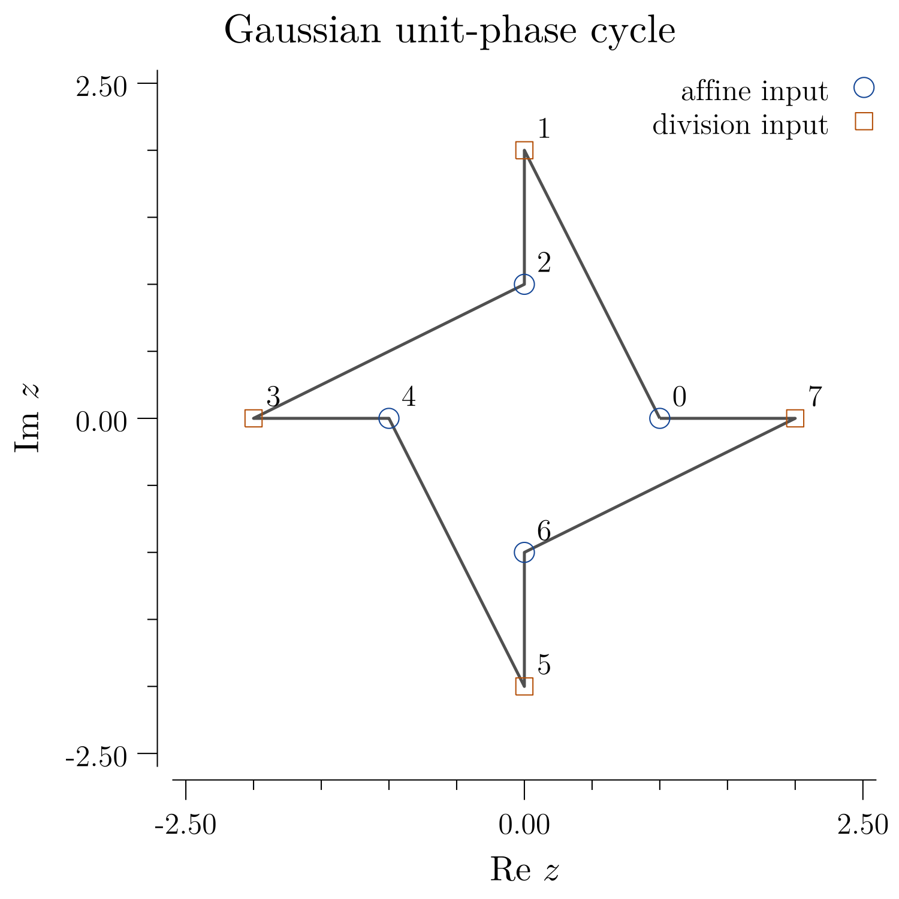
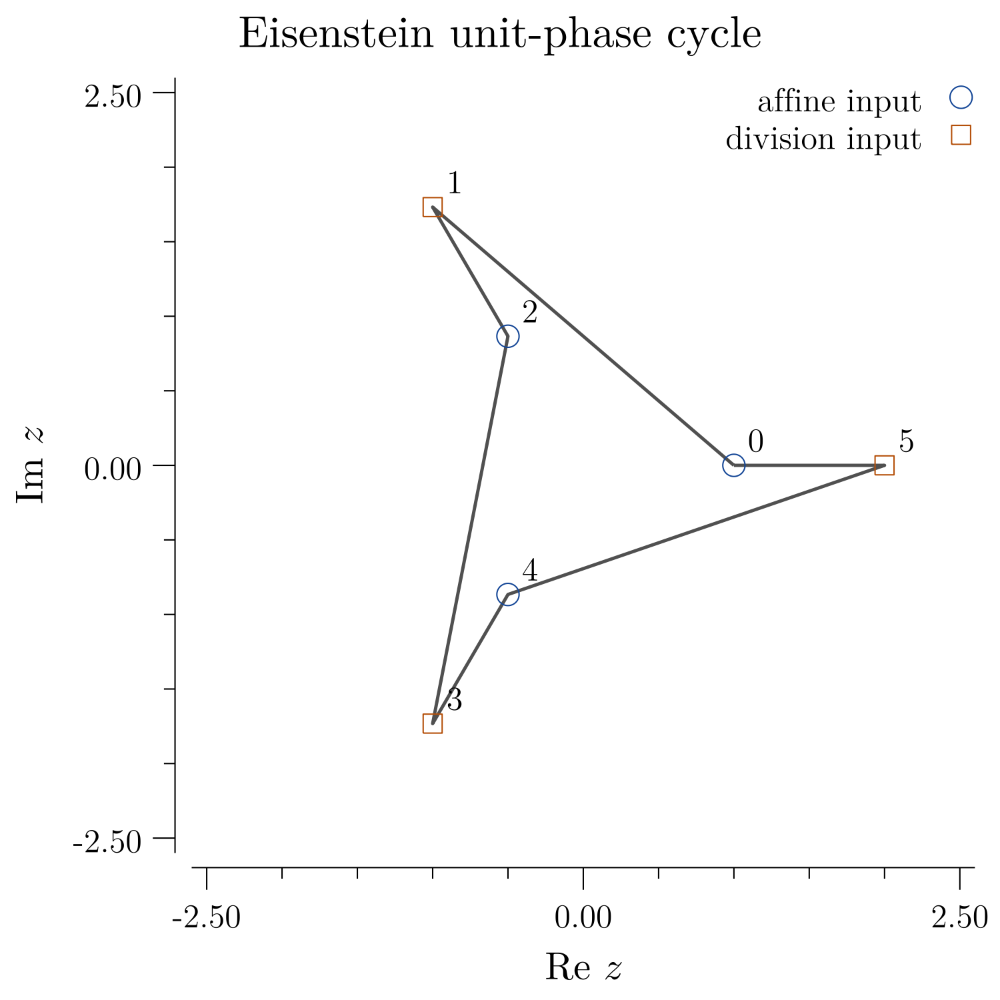
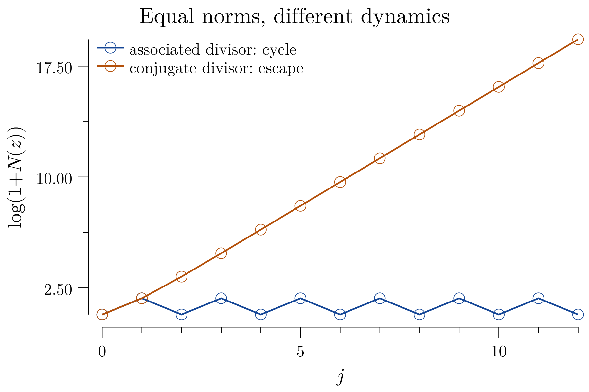
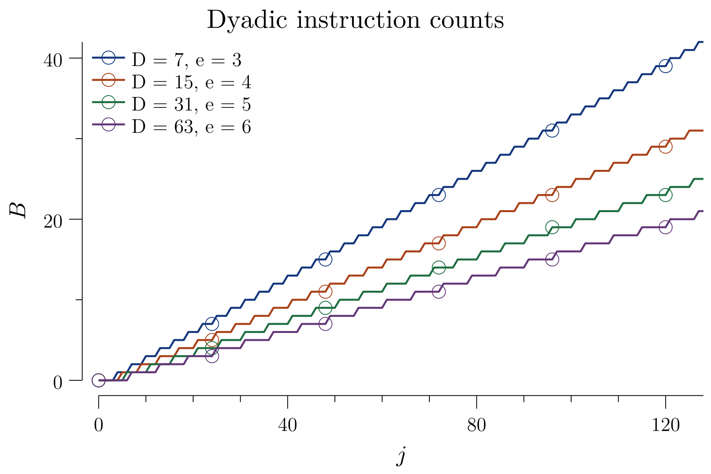
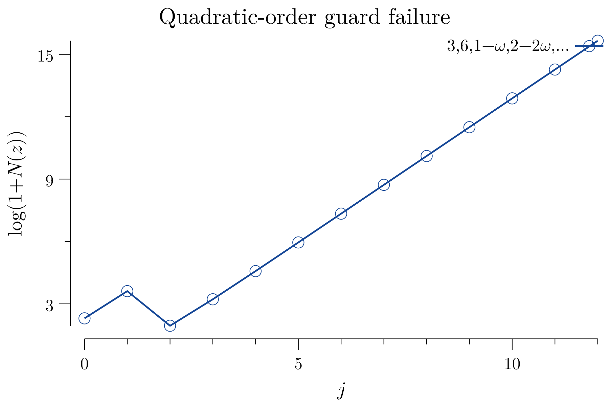

# Exact division and escape in quadratic orders

Let $`R=\mathbb Z[w]`$, where $`w^2-\tau w+\nu=0`$ and $`\tau^2<4\nu`$.
The raw map is
```math
T(z)=
\begin{cases}
z/d,&d\mid z\text{ in }R,\\ qz+c,&d\nmid z\text{ in }R,
\end{cases}
\qquad d\ne0.
```

For $`d=s+tw`$, its norm is $`n=s^2+\tau st+\nu t^2`$. Exact division is equivalent to
```math
n\mid(s+\tau t)x+\nu ty,\qquad n\mid-tx+sy.
```
A triangular ideal basis gives exactly $`n`$ residue classes. Both the guard and quotient retain the chosen order; neither requires unique factorization of elements.

## A complete homogeneous family

For
```math
R_D=\mathbb Z[\sqrt{-D}],\qquad
q=2,\quad c=0,\quad d=1+\sqrt{-D},\qquad D\ge1,
```
every nonzero seed is eventually periodic with primitive period twelve when $`D=1`$ or $`D=3`$. For every other $`D`$, every nonzero raw trajectory escapes along the full sequence.

The obstruction is exact element dependence, not merely equal norms:
```math
2^a=(1+\sqrt{-D})^b\quad(a,b>0)
\quad\Longleftrightarrow\quad D\in\{1,3\}.
```
For $`D=7`$, $`4^3=8^2`$ is a norm balance but cannot produce a return.

## Exact dyadic criticality

For $`D=2^e-1`$ with $`e\ge3`$, the instruction word eventually has primitive period $`e`$: $`e-1`$ affine ticks and one division. This is not a period of the arithmetic states. For every nonzero seed,
```math
\lim_{j\to\infty}\frac{B_j}{j}=\frac1e,
\qquad
\lim_{j\to\infty}\frac{\log|T^j(z)|}{j}
=\frac{e-2}{2e}\log2>0.
```
Writing $`V=v_2(N(z))`$, the explicit bounds are
```math
B_j\le\left\lfloor\frac{j+V}{e}\right\rfloor,
\qquad
N(T^j(z))\ge N(z)2^{((e-2)j-(e+2)V)/e}.
```
The two local valuations retain the order's parity coupling. Division occurs exactly when $`(h,\ell)=(e-1,1)`$ or when $`h\ge e`$ and $`\ell\ge2`$. Selecting the two local branches independently would lose this condition.

## First division

Write $`D+1=2^e m`$ with $`m`$ odd. An initial nonzero integer $`n`$ reaches its first division precisely when $`m\mid n`$. Its first divisible state has index
```math
\max\{0,e-v_2(|n|)\}.
```
The positive-integer density of such seeds is $`1/m`$. This is a first-division density, not an eventual-capture density.

## Odd dyadic offsets

When $`D=2^e-1`$ and the coefficient difference of $`c`$ is odd, the eventual fixed seeds are exactly
```math
0\quad\text{and}\quad -d^r c\quad(r\ge0).
```
The nonzero exceptional seeds reach $`-c`$. Every other seed escapes. After its finite division prefix the trajectory is
```math
2^j(t+c)-c.
```

## Element cancellation fails in the order with $`D=5`$

For $`d=1+\sqrt{-5}`$,
```math
d\mid6,\qquad d\nmid3.
```
The elements $`2,d`$ have no common nonunit element divisor, but admit no Bézout identity. A supplied identity $`aq+bd=1`$, rather than element-gcd cancellation, preserves the division guard.

## Exact finite certificate

The bounded certificate checks $`372704`$ entries: five orders with divisor coefficients in $`[-4,4]`$ and seed coefficients in $`[-6,6]`$; first division for $`1\le D\le64`$ and $`-256\le n\le256`$; and $`672`$ nonzero dyadic seeds for $`e=3,4,5,6`$. Independent integer-matrix references check $`128`$ dyadic instructions per seed on the smaller coefficient grid $`[-4,4]`$. The infinite statements follow from the proofs, not these finite tests.

The seven figures distinguish integer first-division densities, the projected
finite mesh, unit-phase cycles, equal-norm dynamics, failed element cancellation,
and exact dyadic instruction counts. Each has an ignored vector PDF and a
GitHub-visible 300-dpi PNG, at 1800×1200 pixels for 6in×4in or 1500×1500 for
5in×5in. The label renderer accepts only the ten expressions used in these
figures; it is not a general TeX parser.

## Visual arithmetic survey

| First-division density on integer seeds | Finite surface, not a continuous basin |
|---|---|
|  |  |

| Gaussian unit-phase cycle | Eisenstein unit-phase cycle |
|---|---|
|  |  |

| Equal norms, unequal arithmetic dynamics | Exact dyadic instruction counts |
|---|---|
|  |  |



These displays use the actual complex embeddings. Finite meshes and plotted
sample trajectories do not constitute an exhaustive infinite-family proof.

## Verification scope

The detailed TeX supplies the infinite-family arguments. The Lean modules
check norm positivity and multiplication, exact coordinate division and
uniqueness, triangular ideal membership, the cancellation counterexample,
and dyadic guard/block and exceptional norm-drop lemmas. The entire written
uniform-$`D`$ classification is **not yet one complete Lean formalization**;
that part of the broader migration remains open. This distinguishes a
written proof from a finished formalization without weakening its statement.

```bash
export PATH="$HOME/.local/go/bin:$HOME/.elan/bin:$PATH"
CGO_ENABLED=0 go test ./QCD.QuadraticArithmetic.001/go
make go GOFILE=QCD.QuadraticArithmetic.001/go/QuadraticArithmetic.go
make tex TEXFILE=QCD.QuadraticArithmetic.001/tex/QuadraticArithmetic.tex
bash Scripts/CheckIgnoredPdfs.sh
bash Scripts/CheckIgnoredTexTemps.sh
```

[Detailed proofs](tex/QuadraticArithmetic.tex) ·
[Coordinate lemmas](lean/QuadraticArithmetic.lean) ·
[Dyadic lemmas](lean/DyadicArithmetic.lean) ·
[Exact bounded arithmetic and figures](go/QuadraticArithmetic.go).
