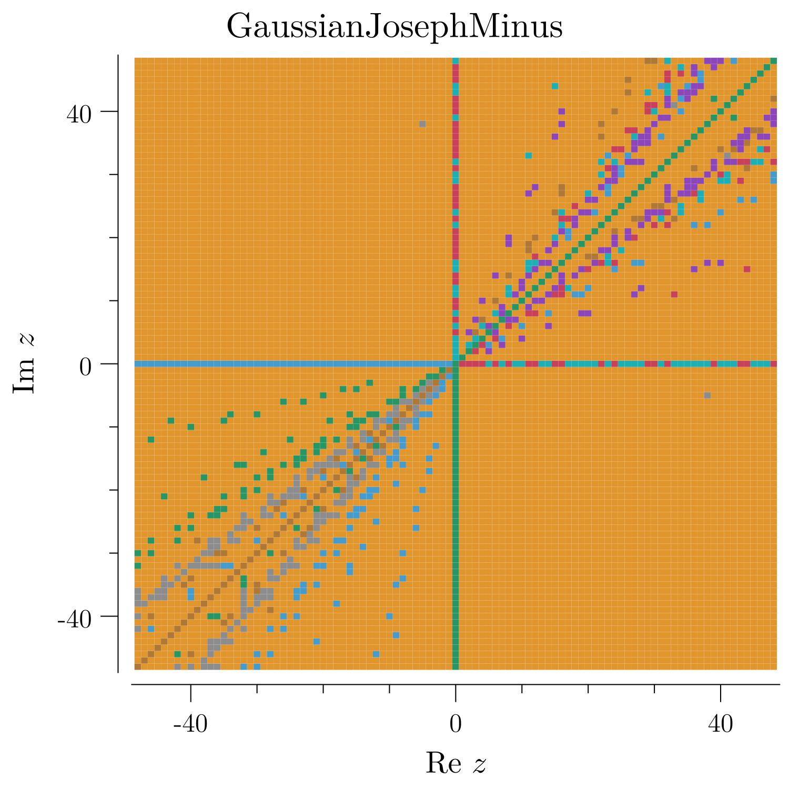

<!-- SPDX-License-Identifier: CC-BY-4.0 -->
# Generalized Collatz Library

## Raw map

For $q,c,d\in\mathbb Z$ with $|d|\ge2$, define
$$
F_{q,c,d}(n)=
\begin{cases}
n/d,&d\mid n,\\
qn+c,&d\nmid n.
\end{cases}
$$
The divisor retains its sign. Division has precedence, including at zero.
The classical raw map is $F_{3,1,2}$.

## Complex rings, cohomology, and visual atlas

The [complex atlas](QCD.ComplexAtlas.001/README.md) studies **13 lattice families**
over Gaussian and Eisenstein integers, four finite quadratic rings, and four
explicit polynomial countermodels. It includes 19 GitHub-visible PNG panels,
exact marked-cycle data, reproduction commands, and a
[source audit](QCD.ComplexAtlas.001/ResearchAudit.md).

| Result or model | Status and actual gain | What remains separate |
|---|---|---|
| [Off-axis raw $(3,c,2)$ escape](QCD.ComplexLattice.001/README.md), odd real integral $c$ | **Checked theorem:** every nonreal lattice seed escapes; at most $2v_2(y)$ ticks to an odd transverse coefficient | Integer-axis dynamics and other parameters |
| [Gaussian split-prime escape](QCD.GaussianDynamics.001/README.md), $(q,c,d)=(2+i,0,2-i)$ | **Checked theorem:** every nonzero Gaussian seed escapes although multiplier and divisor have equal norm | Offsets and noncoprime ring parameters |
| [Ordinary and twisted cohomology](QCD.ComplexCohomology.001/README.md) | **Checked:** ordinary cycle quotient, all finite functional-graph dimensions, actual twisted quotients, and the scalar closing equation $(1-P)u=B$ | Branch admissibility, integer reconstruction, and universal capture |
| [Quadratic Galois fields](QCD.ComplexAtlas.001/README.md#actual-quadratic-galois-fields-with-ramified-negative-controls) | **Checked:** actual $\mathbb F_9,\mathbb F_4$ field structures, exhaustive two-element Galois groups, and same-clock affine conjugacy | Ramified nonfields and raw lattice guards remain distinct |
| [Quadratic-order arithmetic](QCD.QuadraticArithmetic.001/README.md) | Exact lattice division and ideal quotients; bounded computational checks in five orders | Existing trajectory classifications have the formalization scope stated there |
| [Residue-wise complex quotient maps](QCD.ComplexLattice.001/README.md#a-different-complex-family-really-does-have-nonreal-cycles) | **Checked construction:** nonreal fixed points and cycles, unlike the raw scalar map | Global classification of quotient-map basins |
| [Polynomial Julia countermodels](QCD.ComplexAtlas.001/README.md#julia-portraits-same-lattice-cycle-different-complex-stability) | **Checked:** equal finite cycle values can have different multipliers; radius $8$ certifies exterior escape | No canonical Julia set or Julia-to-lattice transfer is asserted |

In the raw $(3,-1,2)$ map, navy marks **proved nonreal escape**, not a
fractal recurrent basin. A residue-wise quotient uses a different guard and
branch formula, and does have nonreal cycles:

The continuous portraits below come from specified holomorphic polynomials,
not from the discontinuous lattice rule. Their selected cycle values agree,
but their stability differs. Finite-time floating-point pixels are not an
exact Julia-membership certificate.

**Field warning:** in any field, every nonzero $d$ divides every $z$.
Consequently the literal raw field extension is only $z\mapsto z/d$.
The finite-field examples instead study specified affine maps and their
functional-graph cohomology. The [verification ledger](QCD.ComplexAtlas.001/Verification.md)
records exact checks and their limits.

## Source provenance and migration coverage

The [public source catalogue](Library.SourceCatalogue.001/README.md) accounts for
2,195 included current files, retains historical hashes and duplicate identities,
and checks 1,627 current ZIP payloads. Its
[reconciliation ledger](Library.SourceCatalogue.001/other/Reconciliation.json)
records exclusions and exact snapshot differences. The 1,491 current 7z file
entries are header-only; unavailable external archives remain metadata-only.

**Byte provenance is not mathematical review.** The exhaustive source-to-result
crosswalk, reading coverage, and remaining supported-result migration are still
open. A pending assignment is not an exclusion or a claim that a source contains
no result. [Reproduction and verification](Library.SourceCatalogue.001/README.md#reproduction-and-input-contract)
state the scanner's finite scope and safety limits.

## Foundations

[Definitions and theorems](Foundations.Main.StartHere/README.md) ·
[Detailed proofs](Foundations.Main.StartHere/tex/Foundations.tex) ·
[Formal proofs](Foundations.Main.StartHere/lean/GeneralizedCollatz.lean) ·
[Exact arithmetic](Foundations.Main.StartHere/go/Dynamics.go)

- A legal word is the unique raw itinerary of the same length.
- Chronological affine composition retains the full additive offset.
- Legal cycle closure implies $(Q-P)n=B$.
- For $\Delta\ne0$,
  $$
  \frac{|\Delta|}{\gcd(|\Delta|,|b|)}\mid |c|
  \quad\Longleftrightarrow\quad
  \exists n\in\mathbb Z:\ \Delta n=cb.
  $$
  This scalar equation does not imply intermediate branch legality.
- Labelled graphs and marked systems form categories.
- A target-reflecting semiconjugacy transfers capture at the same time.
- A variable-clock semiconjugacy transfers forward capture at the accumulated time.

## Reductions

### Coprime scaling and offset normalization

[QCD.Scaling.001](QCD.Scaling.001/README.md) proves that coprime scaling preserves
the exact raw clock. If
$$
\gcd(|c|,|d|)=1,
\qquad c\mid q^k,
$$
then every signed integer orbit enters $c\mathbb Z$ after at most $k$ affine
events. From that entry onward it is exactly $c$ times an orbit of
$F_{q,1,d}$. This gives an all-seed capture equivalence for arbitrary targets,
with a positive-domain version when $q\ge0$, $c>0$, and $d>0$.

### Supported offset absorption

[QCD.Scaling.002](QCD.Scaling.002/README.md) allows a proper offset factor:
$$
S\mid C,\qquad \gcd(|S|,|D|)=1,\qquad S\mid Q^k.
$$
Every signed seed has one entry and one normalized state whose entire future
raw tail is exactly scaled from $F_{Q,C/S,D}$, after at most $k$
affine events. Arbitrary-target universal capture, every cycle phase, and
primitive raw periods recover with their stated domains and clocks.

For $C\ne0$, repeated gcd removal computes the maximal multiplier-supported divisor
$\Sigma$ of $|C|$, with core offset coprime in magnitude to $Q$.
If $C$ is coprime to $D$, the computed factor is admissible for the same
raw map. For positive offsets, $\Sigma>1$ strictly reduces the offset;
$\Sigma=1$ means it was already coprime to the multiplier.
The exact positive search cutoff is
$H\le\Sigma n$ if and only if
$\lfloor(H+\Sigma-1)/\Sigma\rfloor\le n$.
This normalization does not solve the remaining core capture problem.

### Common-power time compression

[QCD.TimeCompression.001](QCD.TimeCompression.001/README.md) proves the exact
variable-clock transport
$$
(q,c,d)=(d^aQ,d^aC,d)\longmapsto(Q,C,d).
$$
A compressed division costs one original raw step, while a compressed affine
event costs $a+1$. After $k$ compressed steps with $r$ affine events, the
same state occurs at original raw time $k+ar$. Compressed target capture
therefore recovers original target capture for every signed seed. If $a>0$
and $(Q,C)\ne(0,0)$, this is a strict reduction in the coefficient height
$\max\{|q|,|c|\}$; the zero pair gives transport without strict decrease.

### Full-orbit recovery and primitive cycles

[QCD.TimeCompression.002](QCD.TimeCompression.002/README.md) recovers every raw
intermediate state in the common-power reduction, for all signed coefficients
and seeds with $|d|\ge2$. Same-seed magnitude boundedness, full-sequence
magnitude escape and eventual periodicity are equivalent. Target capture is
bidirectional under the sufficient condition that the target retains each
legal division; the exact classical target $1$ satisfies this condition.
No classical convergence assertion follows.

A primitive compressed cycle of length $h$, with $r$ affine instructions,
expands to a primitive raw cycle of length $h+ar$. Every nonzero raw cycle
recovers at an affine phase, and zero has period one. Expansion induces a
bijection of periodic mutual-reachability classes, not a one-step conjugacy
or a bijection of periodic point sets at their original seeds. Signed raw
replay checks the bounded sample independently of the universal formal proofs.

### Common-base super-offset escape

[QCD.CommonBase.001](QCD.CommonBase.001/README.md) classifies every signed seed
for
$$
Q=t^u,\qquad D=t^v,\qquad C=t^a s,\qquad
t\ge2,\quad 0<u<v,\quad \gcd(u,v)=1,\quad a\ge u+v,\quad s\ne0.
$$
The base may be composite and the offset residual need not be a unit.
For a nonzero seed, a finite legal division prefix and a complete phase sweep
give the exact same-seed raw ray
$$
F^{r_0+j(u+v)}(n)
=x+j\,s\,t^{a-u-v+1+k}\sum_{i=0}^{v-1}t^i.
$$
Every nonzero signed seed escapes along the full raw sequence and eventually
has the offset's sign, with explicit magnitude and sign budgets. Zero is the
only periodic point. At the lower threshold, $(Q,C,D)=(2,4,4)$ has the
primitive positive raw cycle $1,6,16,4$, refuting a uniform lowering by one.
The divisor here is positive; other offset regimes and negative divisors are
separate families.

### Exact common-base gcd rebasing

[QCD.CommonBase.002](QCD.CommonBase.002/README.md) removes the preceding
coprime-exponent restriction without changing the raw map. With
$$
g=\gcd(u,v),\quad T=t^g,\quad U=u/g,\quad V=v/g,\quad
A=a/g,\quad S=t^{a\bmod g}s,
$$
the coefficients are exactly $Q=T^U$, $D=T^V$, $C=T^A S$, and
$\gcd(U,V)=1$. Every nonzero signed seed again has full raw magnitude
escape and eventual offset sign, with sweep clock $U+V=(u+v)/g$.
The base and carried residual satisfy $T\le Q$ and $|S|\le|C|$.
For $g>1$, the phase count decreases from $v$ to $v/g$. The result
retains positive divisors, $0<u<v$, and the super-offset threshold.

### High-offset escape for both exponent orderings

[QCD.CommonBase.003](QCD.CommonBase.003/README.md) allows arbitrary positive
exponents $u,v$, including equality, for
$$
Q=t^u,\qquad D=t^v,\qquad C=t^a s,\qquad
t\ge2,\quad a\ge u+v,\quad s\ne0.
$$
Division of $u$ by $v$ gives one coefficient-height reduction to either
the preceding family or a proved signed additive tail. Positive clock
coverage recovers every raw intermediate time. Thus every nonzero signed
seed escapes in magnitude and eventually has the offset's sign; zero is
the only periodic point.

At whole-base phase $k<v$, the exact event clock is
$1+\lfloor(k+u)/v\rfloor$, retaining all consecutive forced divisions.
Gcd rebasing gives a physical sweep of $v/g$ affine edges and $u/g$
division edges, where $g=\gcd(u,v)$, and an exact same-seed ray with
clock $(u+v)/g$. Composite bases and nonunit residuals are allowed.
Negative divisors, nontrivial multiplier residuals and other offset regimes
remain separate families.

### Classical capture recovery and absorbing tails

[QCD.ClassicalRecovery.001](QCD.ClassicalRecovery.001/README.md) treats
$$
(q,c,d)=(3\cdot2^a,2^a3^b,2),\qquad a,b\in\mathbb N.
$$
Every positive compressed seed enters $3^b\mathbb Z$ with at most $b$
affine instructions. One common entry witness determines its whole tail.
At the original entry time, scaling preserves the original raw clock;
comparison with the classical raw map requires the separate binary clock.
The odd target $3^b$ cannot occur at a strict compression-block interior.

For each fixed $a,b$, all positive original seeds reach the exact target
$3^b$ if and only if all positive classical raw seeds reach $1$.
This is a proved equivalence, not a proof of classical convergence or a
pointwise comparison at the same original seed. The designated original
cycle has primitive raw period $a+3$, with every division phase retained.
The more general normalized multiplier $3u$, for odd $u\ne1$, is not
silently identified with the classical multiplier $3$.

### Gcd division barrier and affine escape

[QCD.AffineEscape.001](QCD.AffineEscape.001/README.md) classifies every positive
raw orbit when
$$
q\ge2,
\qquad c\ge1,
\qquad D\ge2,
\qquad \gcd(q,D)\nmid c.
$$
After the finite initial run that removes the largest whole-base power of
$D$ from the seed, no further division is possible. If the remaining state
is $x$, then the exact tail is
$$
q^j x+c\frac{q^j-1}{q-1},
$$
so every positive seed tends to infinity. The condition is sufficient rather
than necessary and supplies no conclusion for the classical cell.

### Multiplicatively independent homogeneous escape

[QCD.Homogeneous.001](QCD.Homogeneous.001/README.md) proves a positive escape
theorem for the homogeneous case $c=0$ when $q,D\ge2$ and
$$
q^a\ne D^b
\qquad\text{for all }a,b\ge1.
$$
Every positive raw orbit is injective and tends to infinity. A nonempty return
would force an equality $q^A=D^E$ from its affine and division counts;
injectivity then upgrades to a full-sequence limit because each bounded set of
positive integers is finite. An exact factor-free power search decides whether
the independence hypothesis holds.

### Multiplicatively dependent homogeneous periodicity

[QCD.Homogeneous.002](QCD.Homogeneous.002/README.md) classifies the complementary
homogeneous case. If $q^a=D^b$ for some positive $a,b$, there is a
primitive presentation
$$
q=t^u,\qquad D=t^v,\qquad \gcd(u,v)=1.
$$
Writing a positive seed as $rt^k$ with $t\nmid r$ makes $r$ invariant and
reduces the raw dynamics to
$$
k\longmapsto
\begin{cases}
k-v,&v\le k,\\
k+u,&k<v.
\end{cases}
$$
After a strictly decreasing transient, this is addition by $u$ modulo
$u+v$. Every positive orbit therefore enters a primitive raw cycle of length
$u+v$, and every iterate is at most $qDn$. Together with
`QCD.Homogeneous.001`, this is a complete positive homogeneous dichotomy for
$q,D\ge2$.

### Unit-multiplier homogeneous fixed points

[QCD.Homogeneous.003](QCD.Homogeneous.003/README.md) classifies the boundary
case $q=1$, $c=0$, and $D\ge2$. Every positive seed has a unique form
$$
n=rD^k,\qquad D\nmid r,
$$
and its exact raw orbit is
$$
T_D^j(n)=rD^{k-j},
$$
with truncated subtraction. Hence it first reaches $r$ at time $k$, then
remains fixed; the positive cycles are exactly the one-point cycles on
positive $D$-free integers. Every iterate is at most its seed. This supplies
the unit-multiplier boundary outside the $q,D\ge2$ dichotomy.

### Additive access and finite cores

[QCD.Additive.001](QCD.Additive.001/README.md) treats $q=1$, $c\ge1$,
and $D\ge2$. Put
$$
g=\gcd(c,D),\qquad L=D/g,\qquad
B=c(L-1),\qquad N=\left\lfloor\frac{B}{D-1}\right\rfloor.
$$
An inaccessible state $g\nmid n$ has the exact escaping tail $n+jc$.
Otherwise there is a unique $0\le\ell<L$ with $D\mid n+\ell c$;
its first-division endpoint is $(n+\ell c)/D$, reached in exactly
$\ell+1$ raw instructions. These endpoints strictly decrease above $N$
and remain in the core when accessible below it. Every positive seed reaches
this finite core or an inaccessible state. With
$$
\delta(n)=(D-1)n-B,\qquad 1\le\varepsilon=\delta(N+1)\le D-1,
$$
the exact condition $D^h\varepsilon>\delta(n)$ gives a raw entry bound
$hL$. Coprime offsets have $N=c$ and no traps; an empty core forces
full-sequence escape.

### Complete positive additive cycle classification

[QCD.Additive.002](QCD.Additive.002/README.md) classifies every positive raw
cycle for $q=1$, $c\ge1$, and $D\ge2$. Extract
$$
c=st,\qquad \gcd(t,D)=1,\qquad s\mid D^k,
\qquad M=\left\lfloor\frac{t(D/\gcd(c,D)-1)}{D-1}\right\rfloor.
$$
The primitive cycles are exactly the full orbits of inverse multiplication by
$D$ modulo $t$ whose positive representatives all lie at most $M$.
An edge $m\to m'$ expands into $(Dm'-m)/t$ additions and one division
starting at $sm$, preserving its least raw period. For modular period $h$,
$$
h=\operatorname{ord}_{t/\gcd(m_0,t)}(D),\qquad
P=h+\frac{(D-1)\sum_{i<h}m_i}{t},\qquad h\le t\le c.
$$
Residue zero is represented by $t$; modulus-one order is one. The window
prevents noncoprime scaling ghosts, and the raw clock is grouped before
division. Complete enumeration consumes at most $t$ modular-state visits,
with preprocessing, big-integer arithmetic and expansion costs separate.

### Positive additive all-seed outcomes

[QCD.Additive.003](QCD.Additive.003/README.md) closes the positive all-seed
classification for exactly $q=1$, $c\ge1$, and $D\ge2$. Every seed
is eventually periodic or reaches an inaccessible phase with an exact
escaping affine tail. In particular,
$$
\text{every positive seed is eventually periodic}
\quad\Longleftrightarrow\quad \gcd(c,D)=1.
$$
With the same core radius $N$ and access length $L$, a seed $n$ has
an outcome phase at raw time $u\le(n+N)L$, and a return witness has
$0<p\le NL$. Escape is equivalent to a finite trap witness; universal
escape is equivalent to the absence of a positive raw cycle, decidable by
the complete whole-orbit test above. The bounded arbitrary-precision outcome
checker distinguishes resource refusal from certified periodicity or escape.

### Gcd strata of the positive offset map

[QCD.OffsetObstruction.001](QCD.OffsetObstruction.001/README.md) treats the
positive offset map
$$
C(n)=\begin{cases}n/2,&2\mid n,\\3n+c,&2\nmid n,\end{cases}
$$
for a positive integer $c$. Whenever $m\mid c$ with $\gcd(m,6)=1$,
one step preserves $\gcd(n,m)$. Every orbit therefore stays in the stratum
of its seed, the three states $c$, $4c$, $2c$ form a cycle for odd
$c$, and no seed coprime to $m$ enters that cycle. Since the multiples of
$m$ below $N$ number at most $N/m+1$, a basin contained in the
multiples of $m>1$ has upper density at most $1/m$ and omits the seed
$1$. For even $c$ every
odd state has an odd strictly larger successor, while the dyadic prefix of a
positive seed is consumed exactly, so every positive orbit is unbounded.
Instances $c=3^a$ scale the offset-one dynamics by the same factor.

### Return cores of the multiplier $d-1$ map

[QCD.Relations.Core.001](QCD.Relations.Core.001/README.md) treats the
multiplier $q=d-1$ map
$$
C(n)=\begin{cases}n/d,&d\mid n,\\ (d-1)n+c,&d\nmid n,\end{cases}
\qquad d\ge2,\ c\ge1,
$$
with the return map $R$ given by the same formula with the affine branch
divided by $d$. Only the residues $0$ and $c$ are accessible, and $R$
contracts strictly above the core $\{1,\dots,c\}$, which it maps into
itself. Every positive orbit therefore either leaves the accessible set, after
which the original orbit grows strictly and passes every bound, or enters the
core within at most its own number of return steps and is eventually periodic
there. Each return step is realized by one or two instructions, so a return
cycle of length $p$ expands to a raw cycle of length at most $2p$. For the
corner $c=d+1$ with $d\ge3$ the accessible core states are exactly
$1,d,d+1$, with return values $2,1,d+1$, and the only positive raw cycle is
$$
d+1\longmapsto d(d+1)\longmapsto d+1;
$$
the positive periodic points of $C^{k}$ are the two cycle states at even
$k$, so the periodic-point zeta function is $1/(1-z^{2})$. The bounded
certificate checks 186207 cases. A natural-density statement for the
divergent set is not proved and is recorded as open.

### Explicit cycles and the power-of-$d$ intersection

[QCD.Relations.Cycles.001](QCD.Relations.Cycles.001/README.md) collects four
parameter slices of the raw map and proves on each a cycle or divergence
statement together with one intersection statement. At
$d=2$ with $q=2c+1$ an odd state always takes the affine branch: for even
$c\ge1$ the odd states form an invariant set on which every step increases
the state, so every positive seed passes every bound, while for odd $c$ the
gcd with $c$ is a step invariant, so a bounded orbit is periodic inside its
own stratum and for $c>1$ the seed $c$ itself never reaches $1$. The geometric-offset slice $c=3(8^{h}-1)/7$, $q=2c+1$ has
the orbit $T^{\,j+1}(3)=3\cdot2^{3h-j}$ for $j\le3h$, hence a primitive
cycle of length $3h+1$ avoiding $1$. The full-residue-access slice
$c=(d-1)(d^{k-1}-1)$, $q=(d-1)d^{k-1}+1$ has
$T^{\,j+1}(d-1)=(d-1)d^{k-j}$, hence a primitive cycle of length $k+1$
avoiding $1$ once $d\ge3$; at $d=k=2$ it is
the classical cycle $1\mapsto4\mapsto2\mapsto1$. On the intersection slice
$q=d+1$, $c=d-1$ with $d\ge3$, a positive state reaches $1$ exactly
when it is a power of $d$, and no positive iterate of the map returns $1$
to itself; the case $d=2$ fails, since $3$ reaches $1$ there. The bounded
certificate checks 3229604 cases.

### Repunit divisors and the unit cycle

[QCD.Repunit.001](QCD.Repunit.001/README.md) takes the raw map with offset one and
divisor the repunit sum $S_k=1+q+\cdots+q^{k-1}$, so the affine branch is
$n\mapsto qn+1$. The divisor identity $(q-1)S_k=q^k-1$ makes $S_k$ a
divisor of $q^k-1$, and for $q\ge2$, because $q^{j}-1=(q-1)S_j$ is
strictly smaller than $S_k$ for $0<j<k$, the multiplicative order of
$q$ modulo $S_k$ is exactly $k$. The seed $1$ therefore returns to itself after $k$
instructions through the states $S_2,\dots,S_k$, no earlier return occurs, and
the cycle is primitive; the only state mapped to $0$ is $0$ itself. The
return map $R(n)=(q^{k-1}n+S_{k-1})/S_k$ fixes $1$, and the residue walk
$r\mapsto(qr+1)\bmod S_k$ from $0$ visits $S_j\bmod S_k$, is periodic
with period $k$, and its first $k$ residues are pairwise distinct. The
classical instance $q=3$, $k=2$ gives the divisor $4$ and the cycle
$1\mapsto4\mapsto1$. The bounded certificate checks 98311 cases.

### Accessible residues of a divisor slice

[QCD.ResidueAccess.001](QCD.ResidueAccess.001/README.md) uses $q\ge2$, $c\ge1$,
and $D\ge2$ to classify the residue orbit of zero under the affine map
$F(r)=qr+c\bmod D$ attached to the divisor slice of the raw map $T(n)=n/D$ for $D\mid n$ and $T(n)=qn+c$
otherwise. With the repunit sums $G_j(q)=1+q+\cdots+q^{j-1}$, the orbit
value satisfies $F^j(0)\equiv c\,G_j(q)\pmod D$, so the orbit returns to
$0$ exactly when $D\mid c\,G_j(q)$. Dividing out the common factor
$\gcd(c,D(q-1))$ turns that condition into a divisibility by the access
modulus $M=D(q-1)/\gcd(c,D(q-1))$: the orbit returns at time $j$ exactly
when $M\mid q^{j}-1$. **If a positive return exists** (in particular when
$\gcd(q,D)=1$), let $m$ be the least such exponent. Then the orbit is
periodic with period $m$, revisits $0$ exactly at multiples of $m$, has
pairwise distinct first $m$ values, and satisfies $m\le D$; every accessible
residue is reached at a unique index below $m$. Without return, the walk can
enter a cycle avoiding $0$: for $(q,c,D)=(2,1,2)$ it is $0\to1\to1$. Modulo a prime $p$ with $p\nmid c$ and $\gcd(p,q)=1$
the classification closes: the return time is the multiplicative order of
$q$ modulo $p$ when $q\not\equiv1\pmod p$, and it equals the full
period $p$ when $q\equiv1\pmod p$, in which case the orbit exhausts the
residues. The bounded certificate checks 367300 cases.

### Signed trap itineraries

[QCD.SignedTraps.001](QCD.SignedTraps.001/README.md) decides the signed raw
map on an orbit that never divides. If no iterate of the seed is divisible by
$d$, the divisor never acts and the orbit follows the single affine
recursion $n\mapsto qn+c$, so with the offset sum
$T_j(q)=1+q+\cdots+q^{j-1}$ the $j$-th state is
$q^{j}n+c\,T_j(q)$. The multiplier alone then decides the orbit: at $q=0$
the walk reaches the constant offset and the offset is a fixed point, at
$q=1$ it translates by $c$ and escapes every bound when $c\ne0$, at
$q=-1$ it runs the reflection pair $n\mapsto c-n$, and for $|q|\ge2$ the
state is fixed exactly when $(q-1)n+c=0$ and otherwise escapes every bound.
Separately, the affine branch modulo $|d|$ is the walk
$r\mapsto qr+c$, and a seed is trapped exactly when that walk avoids the zero
class at every time. The certificate checks 125708 signed cases.

### Division-free escape and zero-avoiding cycles

[QCD.ProfileDrop.001](QCD.ProfileDrop.001/README.md) gives a finite criterion
for $q,c,d\in\mathbb Z$ with $|q|\ge2$ and $|d|\ge2$. Some positive seed
has a division-free raw orbit whose absolute values tend to infinity if and
only if the affine residue map
$$
r\longmapsto qr+c\pmod{|d|}
$$
has a cycle avoiding zero. A cycle residue has a positive lift with nonzero
affine displacement. Conversely, the first $|d|$ division-free states suffice
to extract a cycle. If no such cycle exists, every signed seed has a divisible
state at some index $j<|d|$; the following transition performs division.

For an odd prime $p$ with $p\mid q-1$ and $p\nmid c$, the affine orbit
from every signed start has a state divisible by $p^a$ before index $p^a$.
The binary analogue requires $4\mid q-1$ and odd $c$. These are affine
zero-access statements, not post-division capture theorems.

### Signed core bound

[QCD.SignedCore.001](QCD.SignedCore.001/README.md) proves the integer
estimate that makes a finite invariant core possible. For natural numbers
$A$, $B$, and $m$ with $A<m$, and radius
$N=\lfloor B/(m-A)\rfloor$, a map $H$ obeying
$m\,|H(n)|\le A\,|n|+B$ at every integer contracts every state outside the
radius and preserves the radius. Every orbit enters that finite interval and
is eventually periodic there with a positive period. The argument does not
identify $H$ with a first-division return. The certificate checks 165608
comparisons on the documented grid.

### Ancestral inverse-odd join

[QCD.AncestralJoin.001](QCD.AncestralJoin.001/README.md) starts from
$z=2^{a}3^{b}u-1$ with $a\ge 1$, $b\ge 1$, and $u$ odd, under the
congruence $z\equiv 2^{a}-1\pmod{2^{a+2}}$. With
$I(y)=(2y-1)/3$ and the **shifted halving** $H(y)=(y+1)/2-1$,
the $b$-fold inverse-odd image is $I^b(z)=2^{a+b}u-1$ and
$H(I^b(z))=2^{a+b-1}u-1$. This is not raw division of the odd value by $2$.
The hypotheses force $u\equiv(-1)^b\pmod4$; therefore $2^{a+b}$ does not
divide $H(I^b(z))+1=2^{a+b-1}u$.

### Inverse-odd root and valuation

[QCD.OddRoot.001](QCD.OddRoot.001/README.md) bounds one inverse-odd root.
For a nonnegative seed the root lies between $0$ and the seed. The root of
$8$ is $3$, and the root of $-4$ is $-3$, which is strictly larger
than the seed.

[QCD.ThreeStuck.001](QCD.ThreeStuck.001/README.md) records the exact drop.
If $3$ divides $z+1$ and $I(z)=(2z-1)/3$, then
$v_{3}(I(z)+1)=v_{3}(z+1)-1$. After $k$ legal steps,
$I^{k}(z)+1=2^{k}(z+1)/3^{k}$, so a factor of $3$ remains exactly when
$k$ is strictly smaller than the valuation.

### Equal halves

[QCD.EqualHalves.001](QCD.EqualHalves.001/README.md) uses binary words $U,V$
of **common length $h$ and common odd-letter count $r$**, with odd $q$ and
$Q=2^h-q^r>0$. Put $M=2^h+q^r$. These moduli are coprime, and the
concatenated numerator has denominator closure exactly when both
$M\mid A(U)-A(V)$ and $Q\mid A(U)+A(V)$. The factors can separate: for $q=3$, $h=6$,
and $r=2$ the sum modulus divides the numerator difference, while the
difference modulus does not divide the numerator sum.

### Signed return

The first-division return sends a seed through the affine block
$q^{j}n+c\sum_{i<j}q^{i}$ until the first time the divisor divides that
state, then divides once. On a division-free prefix the raw orbit equals
that affine state. The quotient identity $d\cdot(a/d)=a$ recovers the
numerator, and the absolute value of the return is at most
$(\lvert q\rvert^{j}\lvert n\rvert+\lvert c\rvert\sum_{i<j}\lvert q\rvert^{i})/\lvert d\rvert$.
A seed shifted by a multiple of the divisor has the same first hit.
For multiplier $1$ and an offset coprime to the divisor, every orbit
enters the shell of radius $\lvert c\rvert$ and is eventually periodic
there. For divisor $2$ the period has length at most
$\max(\lvert c\rvert-1,1)$. For divisor $-2$ the same bound holds, and
the shell is entered on the logarithmic scale
$\lfloor\log_{2}(\lvert n\rvert-\lvert c\rvert)\rfloor+1+2\lvert c\rvert$.
The notes are [QCD.SignedReturn.001](QCD.SignedReturn.001/README.md)
through [QCD.SignedReturn.016](QCD.SignedReturn.016/README.md).

### Telescoping weights and mass-ratio bounds

[QCD.RhoComparison.001](QCD.RhoComparison.001/README.md) proves, for
$\rho(n)=1/(n(n+1))$ and $\mu(n)=2/(n(n-1))$,

$$
2\rho(n)\le\mu(n)\le4\rho(n)\qquad(n\ge3).
$$

The reciprocal telescopes give closed partial sums and windows. The positive
series converge, and the bounds pass to any finite or infinite label set
in $\{3,4,\ldots\}$. When the denominator masses are positive, their
quotients differ by at most a factor of $2$. Equality holds in the
upper bound at $n=3$; at $n=2$ the bound fails. Signed sums fail as well:
$4(\rho(3)-\rho(4))=2/15<1/6=\mu(3)-\mu(4)$.
No orbit-capture conclusion follows. The finite arithmetic certificate
checks 28685 cases.

## Other map conventions

A residue-wise affine map has the form
$$
T(n)=\frac{q_r n+c_r}{d},\qquad r=n\bmod d,
\qquad c_r\equiv-q_r r\pmod d.
$$
A common multiplier is the special case $q_r=q$.
This is a different map from raw branching. Shortcut, odd-accelerated and
first-division maps also have their own definitions and clocks.

## Build

`make` and `make lean` build the formal library. The `tex` profile uses pdfLaTeX
and BibTeX with `amsalpha`; the `go` profile uses `CGO_ENABLED=0`.

[Homomorphism theorem examples](Templates/lean/HomomorphismTheorems.lean) ·
[TeX example](Templates/tex/Template.tex) ·
[Go example](Templates/go/HomomorphismTheorems.go)

## License

[CC-BY-4.0](LICENSE.md).
