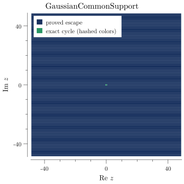
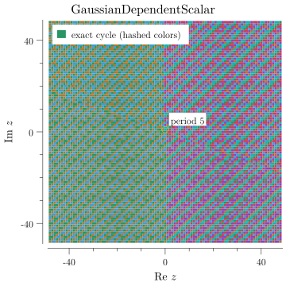
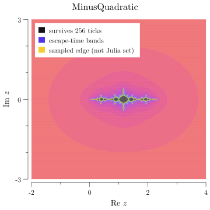
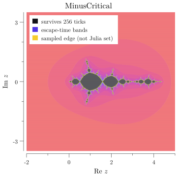

<!-- SPDX-License-Identifier: CC-BY-4.0 -->
# Generalized Collatz Library

This library studies exact dynamics of the division-first maps
$`F_{q,c,d}`$, their integral lattice extensions, and the algebra of legal
branch words. Each theorem specifies its domain, parameters and clock.

For $`q,c,d\in\mathbb Z`$ with $`|d|\ge2`$,

```math
F_{q,c,d}(n)=\begin{cases}n/d,&d\mid n,\\ qn+c,&d\nmid n.\end{cases}
```

The divisor keeps its sign. Division takes precedence, including at zero.
The classical raw map is $`F_{3,1,2}`$: an odd step is $`3n+1`$, not
$`(3n+1)/2`$. Shortcut, odd-return and first-division maps have different clocks.

## Principal results

| Theorem | Parameters and conclusion |
|---|---|
| [Signed homogeneous lattice classification](QCD.ComplexLattice.001/README.md#complete-homogeneous-scalar-classification) | For $`c=0`$ and $`\lvert q\rvert,\lvert d\rvert\ge2`$, every nonzero seed in a specified imaginary quadratic coordinate order escapes in full complex norm when the magnitudes are multiplicatively independent, and is eventually periodic when they are dependent. This includes the integer axis. |
| [Scalar escape with arbitrary real offset](QCD.ComplexLattice.001/README.md#general-scalar-escape-by-arithmetic-independence) | For every integer $`c`$ and independent $`\lvert q\rvert,\lvert d\rvert\ge2`$, every nonreal seed escapes. Infinitely many divisions are allowed. For odd $`c`$ in $`(3,c,2)`$, an explicit division-free tail begins within $`2v_2(\lvert y\rvert)`$ raw ticks. |
| [Positive additive classification](QCD.Additive.003/README.md) | For $`q=1,c\ge1,D\ge2`$, every positive seed is eventually periodic or enters an exact escaping affine tail. All positive seeds are eventually periodic if and only if $`\gcd(c,D)=1`$. [All primitive cycles](QCD.Additive.002/README.md) are recovered from complete finite modular orbits with their raw periods. |
| [Dependent positive homogeneous periods](QCD.Homogeneous.002/README.md) | If $`q=t^u,D=t^v`$, $`t\ge2`$, $`u,v>0`$ and $`\gcd(u,v)=1`$, every positive seed is eventually periodic with primitive raw period $`u+v`$. |
| [Common-base high-offset escape](QCD.CommonBase.001/README.md) | Explicit offset thresholds give full-sequence escape for every nonzero signed seed in the stated common-base families. Gcd rebasing and both exponent orderings retain exact branch and clock recovery. |
| [Strict residue leakage](QCD.ResidueLeakage.001/README.md#strict-leakage) | For $`q\ge2,c\ge1,D\ge2,\gcd(q,D)=1`$, let $`m`$ be the least positive return time of zero under $`r\mapsto qr+c\bmod D`$. If $`m<D`$, exactly $`m^h`$ classes modulo $`D^h`$ have at least $`h`$ divisions; density-one seeds eventually stop dividing and escape. |
| [Full-cycle negative drift](QCD.ResidueLeakage.001/README.md#full-cycle-boundary-and-negative-drift) | At $`m=D`$, marked delays have an exact uniform product law. Negative drift occurs exactly for $`q=3,D=2`$ and positive odd $`c`$; these maps have density-one strict descent. For every fixed positive odd $`c`$ and factor $`C\ge1`$, all but $`O_{c,C}(X^{1-\alpha})`$ seeds at most $`X`$ reach a value below $`n/C`$ within $`O(\log n)`$ raw ticks, with explicit constants and $`\alpha>0`$. This is a stopping-time theorem, not universal capture. |
| [Prime-square nonunit leakage](QCD.ResidueLeakage.001/README.md#prime-square-nonunit-family) | For a prime $`p`$ and positive $`p`$-units $`Q,C`$, the raw family $`(q,c,D)=(pQ,pC,p^2)`$ has density-one full-sequence escape. The surviving unit-return weight is $`p/(p^2-1)<1`$, even though $`\gcd(q,D)\mid c`$. |
| [Signed dyadic affine-tail classification](QCD.DyadicDynamics.001/README.md#complete-opposite-parity-integer-classification) | For $`q+c`$ odd and $`\lvert q\rvert\ge2`$, every nonzero signed seed either reaches its unique possible odd fixed anchor or escapes in magnitude with an exact exponential tail. This includes every positive even-multiplier, odd-offset seed and $`(3,c,2)`$ with nonnegative even $`c`$. |
| [Exact unit and Mersenne clocks](QCD.DyadicDynamics.001/README.md#three-small-multipliers-and-primitive-excursions) | For $`(1,1,2)`$, positive seeds reach one within $`2\lceil\log_2 n\rceil`$ raw ticks. For $`q=2^k-1,c=1`$, the cycle through one has primitive raw period $`k+1`$. |
| [Raw 2-adic golden-mean dynamics](QCD.DyadicDynamics.001/README.md#golden-mean-coding-on-the-2-adic-integers) | Odd $`q,c`$ give a homeomorphic raw-clock conjugacy to the golden-mean shift, entropy $`\log((1+\sqrt5)/2)`$, a mixing invariant probability, and 2-adic zeta function $`1/(1-z-z^2)`$. The first-division clock instead has the full binary shift and preserves Haar. |
| [Even two-affine closure](QCD.TwoAffineEven.001/README.md) | Positive equations $`qn+1=2^a y`$, $`qy+1=2^b n`$ with $`a+b=2t`$ force $`a=b=t`$, $`q=2^t-1`$, $`n=y=1`$. Unequal-component closures therefore require odd total division length. |
| [Legal three-affine criterion](QCD.ThreeAffineClosure.001/README.md) | For positive $`a,b,c,q`$, a positive odd three-letter closure exists exactly when $`q`$ is odd, $`\Delta=2^{a+b+c}-q^3>0`$, and $`\Delta\mid q^2+q2^a+2^{a+b}`$. Rotated quotients recover all phases and exact valuations. |
| [Classical smaller-parent residual reduction](QCD.ClassicalCoalescence.001/README.md#uniform-second-burst-joins) | Explicit legal joins reduce positive capture to a residual set of natural density $`11/324`$. Uniform second-burst parents remove half of each previously residual $`a=2`$ or $`a=3`$ class. Every covered seed has $`0<p<n`$, $`9p\le8n`$, and logarithmic parent depth; capture on the remaining residual is not proved. |
| [Classical short-cycle classification](QCD.ThreeAffineClosure.001/README.md#classical-closures-with-at-most-five-odd-states) | Every positive classical odd-return closure with at most five edges repeats the unit state with every division exponent equal to two. The complete three-edge classification and the finite five-edge obstruction have Lean proofs. |
| [Three-crossing equal-halves obstruction](QCD.NoCrossing.001/README.md#three-crossing-extension) | Moving one odd letter across at most three common odd letters never satisfies the equal-halves difference modulus. This excludes the specified positive cycle words uniformly in their length. |
| [Terminal-prefix equivalence and repetition budget](QCD.ClassicalCoalescence.001/README.md#terminal-prefix-equivalence) | Terminal powers in the legal prefix $`1^a01`$ have an exact odd parameterization and arrival clock. Any fixed shortcut word has a sharp repeated-copy budget from its affine displacement; switching between words is not controlled. |
| [Clock-correct transformations](QCD.TimeCompression.002/README.md) · [supported offset absorption](QCD.Scaling.002/README.md) | Scaling and compression transfer states, capture, primitive cycles and behavior with proved same-clock or accumulated-clock formulas. |
| [Marked cycle resonance](QCD.ComplexCohomology.001/Resonance.md) | The legal raw minus cycle of period $`18`$ has defect $`3^7-2^{11}=139`$. Its twisted quotient is one-dimensional in characteristic $`139`$, with a genuine Frobenius action and fixed/sign reconstruction. Coefficient reduction does not create a raw finite-field map. |

The 2-adic symbolic, measure, entropy and zeta theorems have detailed written
proofs; they do not classify integer capture. The density theorems at full access
and in the prime-square family also have detailed written proofs. Their Lean companions establish the finite weighted bounds,
invariant layer and legal block recovery; they do not yet state the complete
infinite density theorems. The other links distinguish written results from
their precise formal interfaces.

## One branch-word algebra, several dynamical mechanisms

A legal word carries ordered affine data $`(P,Q,B)`$:

```math
Q\,F^n(x)=Px+B,\qquad P=q^a,\quad Q=d^b,\quad a+b=n.
```

An affine tick sends $`(P,Q,B)`$ to $`(qP,Q,qB+cQ)`$; a division tick sends it
to $`(P,dQ,B)`$. Thus the full offset and every clock are retained.
Closure requires $`(Q-P)x=B`$, but the scalar equation alone does not supply
the intermediate guards.

The [affine cocycle](QCD.ComplexCohomology.001/DynamicalCocycle.md) connects
cycle torsion, homogeneous content, additive cores and residue drift.
It has different useful specializations, not a claim that one unmarked scalar
classifies every orbit. [Arithmetic profiles](QCD.ProfileDrop.001/ArithmeticProfiles.md)
describe the domains and roles of integer and pair observables. In particular,
division loses one digit of residue precision; no fixed positive $`d`$-adic
precision recovers every raw successor.

## Complex lattices, fields and continuous models

For $`\theta^2=\tau\theta-\nu`$ with $`\tau,\nu\in\mathbb Z`$ and
$`4\nu>\tau^2`$, use $`R=\mathbb Z+\mathbb Z\theta`$ and

```math
\theta=\frac{\tau+i\sqrt{4\nu-\tau^2}}2.
```

Gaussian integers have $`(\tau,\nu)=(0,1)`$; Eisenstein integers have
$`(-1,1)`$. Scalar divisibility means divisibility of **both** integral
coordinates. Nonscalar divisors use the order's multiplication table and
are treated by [quadratic arithmetic](QCD.QuadraticArithmetic.001/README.md).

Three distinct constructions appear in the [complex dynamics](QCD.ComplexDynamics.001/README.md):

- **Raw lattice maps** retain element divisibility and division precedence.
  [Gaussian split-prime escape](QCD.GaussianDynamics.001/README.md) shows that
  equal multiplier/divisor norms need not imply periodicity.
- **Residue-wise quotient maps** use $`(3z\pm r(z))/2`$ on nonzero residues.
  They have nonreal cycles and are not fixed-offset raw maps.
- **Holomorphic polynomial models** preserve selected cycle values but can
  have different multipliers and basins. Their continuous portraits are
  not invariants of the lattice rule.

| Raw Gaussian homogeneous dynamics | Dependent homogeneous cycle |
|---|---|
|  |  |

| Repelling minus-cycle polynomial | Superattracting minus-cycle polynomial |
|---|---|
|  |  |

The SVG panels contain vector geometry and outlined labels. Polynomial colors
record finite binary64 escape times; dark means survival for the declared
horizon, not certified Julia membership. Legends and optional annotations
identify the quantity shown.

In a field, every nonzero $`d`$ divides every $`z`$. A literal raw field
extension is therefore only $`z\mapsto z/d`$. The finite-field examples
instead study specified affine maps, actual quadratic Galois groups, and
[ordinary or twisted cochains](QCD.ComplexCohomology.001/README.md). Their
coefficient arithmetic is kept separate from integral branch recovery.

[Cycle-lattice arithmetic](QCD.ComplexCohomology.001/CycleArithmetic.md) gives
the integral cyclic cokernel and offset conductor.
[Analytic extensions](QCD.ComplexDynamics.001/AnalyticClaims.md) explain why
integer-wide interpolation still does not determine complex stability.
[Related literature](QCD.ComplexDynamics.001/Literature.md) identifies the
different map conventions; the [source index](Library.SourceCatalogue.001/README.md)
locates the independent local corpus.

## Foundations

[Definitions and theorems](Foundations.Main.StartHere/README.md) ·
[Detailed proofs](Foundations.Main.StartHere/tex/Foundations.tex) ·
[Formal proofs](Foundations.Main.StartHere/lean/GeneralizedCollatz.lean) ·
[Exact arithmetic](Foundations.Main.StartHere/go/Dynamics.go)

- A legal word is the unique raw itinerary of the same length.
- Chronological affine composition retains the full additive offset.
- Legal cycle closure implies $`(Q-P)n=B`$.
- For $`\Delta\ne0`$,
```math
\frac{|\Delta|}{\gcd(|\Delta|,|b|)}\mid |c|
  \quad\Longleftrightarrow\quad
  \exists n\in\mathbb Z:\ \Delta n=cb.
```
  This scalar equation does not imply intermediate branch legality.
- Labelled graphs and marked systems form categories.
- A target-reflecting semiconjugacy transfers capture at the same time.
- A variable-clock semiconjugacy transfers forward capture at the accumulated time.

## Reductions

### Coprime scaling and offset normalization

[QCD.Scaling.001](QCD.Scaling.001/README.md) proves that coprime scaling preserves
the exact raw clock. If
```math
\gcd(|c|,|d|)=1,
\qquad c\mid q^k,
```
then every signed integer orbit enters $`c\mathbb Z`$ after at most $`k`$ affine
events. From that entry onward it is exactly $`c`$ times an orbit of
$`F_{q,1,d}`$. This gives an all-seed capture equivalence for arbitrary targets,
with a positive-domain version when $`q\ge0`$, $`c>0`$, and $`d>0`$.

### Supported offset absorption

[QCD.Scaling.002](QCD.Scaling.002/README.md) allows a proper offset factor:
```math
S\mid C,\qquad \gcd(|S|,|D|)=1,\qquad S\mid Q^k.
```
Every signed seed has one entry and one normalized state whose entire future
raw tail is exactly scaled from $`F_{Q,C/S,D}`$, after at most $`k`$
affine events. Arbitrary-target universal capture, every cycle phase, and
primitive raw periods recover with their stated domains and clocks.

For $`C\ne0`$, repeated gcd removal computes the maximal multiplier-supported divisor
$`\Sigma`$ of $`|C|`$, with core offset coprime in magnitude to $`Q`$.
If $`C`$ is coprime to $`D`$, the computed factor is admissible for the same
raw map. For positive offsets, $`\Sigma>1`$ strictly reduces the offset;
$`\Sigma=1`$ means it was already coprime to the multiplier.
The exact positive search cutoff is
$`H\le\Sigma n`$ if and only if
$`\lfloor(H+\Sigma-1)/\Sigma\rfloor\le n`$.
This normalization does not solve the remaining core capture problem.

### Common-power time compression

[QCD.TimeCompression.001](QCD.TimeCompression.001/README.md) proves the exact
variable-clock transport
```math
(q,c,d)=(d^aQ,d^aC,d)\longmapsto(Q,C,d).
```
A compressed division costs one original raw step, while a compressed affine
event costs $`a+1`$. After $`k`$ compressed steps with $`r`$ affine events, the
same state occurs at original raw time $`k+ar`$. Compressed target capture
therefore recovers original target capture for every signed seed. If $`a>0`$
and $`(Q,C)\ne(0,0)`$, this is a strict reduction in the coefficient height
$`\max\{|q|,|c|\}`$; the zero pair gives transport without strict decrease.

### Full-orbit recovery and primitive cycles

[QCD.TimeCompression.002](QCD.TimeCompression.002/README.md) recovers every raw
intermediate state in the common-power reduction, for all signed coefficients
and seeds with $`|d|\ge2`$. Same-seed magnitude boundedness, full-sequence
magnitude escape and eventual periodicity are equivalent. Target capture is
bidirectional under the sufficient condition that the target retains each
legal division; the exact classical target $`1`$ satisfies this condition.
No classical convergence assertion follows.

A primitive compressed cycle of length $`h`$, with $`r`$ affine instructions,
expands to a primitive raw cycle of length $`h+ar`$. Every nonzero raw cycle
recovers at an affine phase, and zero has period one. Expansion induces a
bijection of periodic mutual-reachability classes, not a one-step conjugacy
or a bijection of periodic point sets at their original seeds. Signed raw
replay checks the bounded sample independently of the universal formal proofs.

### Common-base super-offset escape

[QCD.CommonBase.001](QCD.CommonBase.001/README.md) classifies every signed seed
for
```math
Q=t^u,\qquad D=t^v,\qquad C=t^a s,\qquad
t\ge2,\quad 0<u<v,\quad \gcd(u,v)=1,\quad a\ge u+v,\quad s\ne0.
```
The base may be composite and the offset residual need not be a unit.
For a nonzero seed, a finite legal division prefix and a complete phase sweep
give the exact same-seed raw ray
```math
F^{r_0+j(u+v)}(n)
=x+j\,s\,t^{a-u-v+1+k}\sum_{i=0}^{v-1}t^i.
```
Every nonzero signed seed escapes along the full raw sequence and eventually
has the offset's sign, with explicit magnitude and sign budgets. Zero is the
only periodic point. At the lower threshold, $`(Q,C,D)=(2,4,4)`$ has the
primitive positive raw cycle $`1,6,16,4`$, refuting a uniform lowering by one.
The divisor here is positive; other offset regimes and negative divisors are
separate families.

### Exact common-base gcd rebasing

[QCD.CommonBase.002](QCD.CommonBase.002/README.md) removes the preceding
coprime-exponent restriction without changing the raw map. With
```math
g=\gcd(u,v),\quad T=t^g,\quad U=u/g,\quad V=v/g,\quad
A=a/g,\quad S=t^{a\bmod g}s,
```
the coefficients are exactly $`Q=T^U`$, $`D=T^V`$, $`C=T^A S`$, and
$`\gcd(U,V)=1`$. Every nonzero signed seed again has full raw magnitude
escape and eventual offset sign, with sweep clock $`U+V=(u+v)/g`$.
The base and carried residual satisfy $`T\le Q`$ and $`|S|\le|C|`$.
For $`g>1`$, the phase count decreases from $`v`$ to $`v/g`$. The result
retains positive divisors, $`0<u<v`$, and the super-offset threshold.

### High-offset escape for both exponent orderings

[QCD.CommonBase.003](QCD.CommonBase.003/README.md) allows arbitrary positive
exponents $`u,v`$, including equality, for
```math
Q=t^u,\qquad D=t^v,\qquad C=t^a s,\qquad
t\ge2,\quad a\ge u+v,\quad s\ne0.
```
Division of $`u`$ by $`v`$ gives one coefficient-height reduction to either
the preceding family or a proved signed additive tail. Positive clock
coverage recovers every raw intermediate time. Thus every nonzero signed
seed escapes in magnitude and eventually has the offset's sign; zero is
the only periodic point.

At whole-base phase $`k<v`$, the exact event clock is
$`1+\lfloor(k+u)/v\rfloor`$, retaining all consecutive forced divisions.
Gcd rebasing gives a physical sweep of $`v/g`$ affine edges and $`u/g`$
division edges, where $`g=\gcd(u,v)`$, and an exact same-seed ray with
clock $`(u+v)/g`$. Composite bases and nonunit residuals are allowed.
Negative divisors, nontrivial multiplier residuals and other offset regimes
remain separate families.

### Classical capture recovery and absorbing tails

[QCD.ClassicalRecovery.001](QCD.ClassicalRecovery.001/README.md) treats
```math
(q,c,d)=(3\cdot2^a,2^a3^b,2),\qquad a,b\in\mathbb N.
```
Every positive compressed seed enters $`3^b\mathbb Z`$ with at most $`b`$
affine instructions. One common entry witness determines its whole tail.
At the original entry time, scaling preserves the original raw clock;
comparison with the classical raw map requires the separate binary clock.
The odd target $`3^b`$ cannot occur at a strict compression-block interior.

For each fixed $`a,b`$, all positive original seeds reach the exact target
$`3^b`$ if and only if all positive classical raw seeds reach $`1`$.
This is a proved equivalence, not a proof of classical convergence or a
pointwise comparison at the same original seed. The designated original
cycle has primitive raw period $`a+3`$, with every division phase retained.
The more general normalized multiplier $`3u`$, for odd $`u\ne1`$, is not
silently identified with the classical multiplier $`3`$.

### Gcd division barrier and affine escape

[QCD.AffineEscape.001](QCD.AffineEscape.001/README.md) classifies every positive
raw orbit when
```math
q\ge2,
\qquad c\ge1,
\qquad D\ge2,
\qquad \gcd(q,D)\nmid c.
```
After the finite initial run that removes the largest whole-base power of
$`D`$ from the seed, no further division is possible. If the remaining state
is $`x`$, then the exact tail is
```math
q^j x+c\frac{q^j-1}{q-1},
```
so every positive seed tends to infinity. The condition is sufficient rather
than necessary and supplies no conclusion for the classical cell.

### Multiplicatively independent homogeneous escape

[QCD.Homogeneous.001](QCD.Homogeneous.001/README.md) proves a positive escape
theorem for the homogeneous case $`c=0`$ when $`q,D\ge2`$ and
```math
q^a\ne D^b
\qquad\text{for all }a,b\ge1.
```
Every positive raw orbit is injective and tends to infinity. A nonempty return
would force an equality $`q^A=D^E`$ from its affine and division counts;
injectivity then upgrades to a full-sequence limit because each bounded set of
positive integers is finite. An exact factor-free power search decides whether
the independence hypothesis holds.

### Multiplicatively dependent homogeneous periodicity

[QCD.Homogeneous.002](QCD.Homogeneous.002/README.md) classifies the complementary
homogeneous case. If $`q^a=D^b`$ for some positive $`a,b`$, there is a
primitive presentation
```math
q=t^u,\qquad D=t^v,\qquad \gcd(u,v)=1.
```
Writing a positive seed as $`rt^k`$ with $`t\nmid r`$ makes $`r`$ invariant and
reduces the raw dynamics to
```math
k\longmapsto
\begin{cases}
k-v,&v\le k,\\ k+u,&k<v.
\end{cases}
```
After a strictly decreasing transient, this is addition by $`u`$ modulo
$`u+v`$. Every positive orbit therefore enters a primitive raw cycle of length
$`u+v`$, and every iterate is at most $`qDn`$. Together with
`QCD.Homogeneous.001`, this is a complete positive homogeneous dichotomy for
$`q,D\ge2`$.

### Unit-multiplier homogeneous fixed points

[QCD.Homogeneous.003](QCD.Homogeneous.003/README.md) classifies the boundary
case $`q=1`$, $`c=0`$, and $`D\ge2`$. Every positive seed has a unique form
```math
n=rD^k,\qquad D\nmid r,
```
and its exact raw orbit is
```math
T_D^j(n)=rD^{k-j},
```
with truncated subtraction. Hence it first reaches $`r`$ at time $`k`$, then
remains fixed; the positive cycles are exactly the one-point cycles on
positive $`D`$-free integers. Every iterate is at most its seed. This supplies
the unit-multiplier boundary outside the $`q,D\ge2`$ dichotomy.

### Additive access and finite cores

[QCD.Additive.001](QCD.Additive.001/README.md) treats $`q=1`$, $`c\ge1`$,
and $`D\ge2`$. Put
```math
g=\gcd(c,D),\qquad L=D/g,\qquad
B=c(L-1),\qquad N=\left\lfloor\frac{B}{D-1}\right\rfloor.
```
An inaccessible state $`g\nmid n`$ has the exact escaping tail $`n+jc`$.
Otherwise there is a unique $`0\le\ell<L`$ with $`D\mid n+\ell c`$;
its first-division endpoint is $`(n+\ell c)/D`$, reached in exactly
$`\ell+1`$ raw instructions. These endpoints strictly decrease above $`N`$
and remain in the core when accessible below it. Every positive seed reaches
this finite core or an inaccessible state. With
```math
\delta(n)=(D-1)n-B,\qquad 1\le\varepsilon=\delta(N+1)\le D-1,
```
the exact condition $`D^h\varepsilon>\delta(n)`$ gives a raw entry bound
$`hL`$. Coprime offsets have $`N=c`$ and no traps; an empty core forces
full-sequence escape.

### Complete positive additive cycle classification

[QCD.Additive.002](QCD.Additive.002/README.md) classifies every positive raw
cycle for $`q=1`$, $`c\ge1`$, and $`D\ge2`$. Extract
```math
c=st,\qquad \gcd(t,D)=1,\qquad s\mid D^k,
\qquad M=\left\lfloor\frac{t(D/\gcd(c,D)-1)}{D-1}\right\rfloor.
```
The primitive cycles are exactly the full orbits of inverse multiplication by
$`D`$ modulo $`t`$ whose positive representatives all lie at most $`M`$.
An edge $`m\to m'`$ expands into $`(Dm'-m)/t`$ additions and one division
starting at $`sm`$, preserving its least raw period. For modular period $`h`$,
```math
h=\operatorname{ord}_{t/\gcd(m_0,t)}(D),\qquad
P=h+\frac{(D-1)\sum_{i<h}m_i}{t},\qquad h\le t\le c.
```
Residue zero is represented by $`t`$; modulus-one order is one. The window
prevents noncoprime scaling ghosts, and the raw clock is grouped before
division. Complete enumeration consumes at most $`t`$ modular-state visits,
with preprocessing, big-integer arithmetic and expansion costs separate.

### Positive additive all-seed outcomes

[QCD.Additive.003](QCD.Additive.003/README.md) closes the positive all-seed
classification for exactly $`q=1`$, $`c\ge1`$, and $`D\ge2`$. Every seed
is eventually periodic or reaches an inaccessible phase with an exact
escaping affine tail. In particular,
```math
\text{every positive seed is eventually periodic}
\quad\Longleftrightarrow\quad \gcd(c,D)=1.
```
With the same core radius $`N`$ and access length $`L`$, a seed $`n`$ has
an outcome phase at raw time $`u\le(n+N)L`$, and a return witness has
$`0<p\le NL`$. Escape is equivalent to a finite trap witness; universal
escape is equivalent to the absence of a positive raw cycle, decidable by
the complete whole-orbit test above. The bounded arbitrary-precision outcome
checker distinguishes resource refusal from certified periodicity or escape.

### Gcd strata of the positive offset map

[QCD.OffsetObstruction.001](QCD.OffsetObstruction.001/README.md) treats the
positive offset map
```math
C(n)=\begin{cases}n/2,&2\mid n,\\3n+c,&2\nmid n,\end{cases}
```
for a positive integer $`c`$. Whenever $`m\mid c`$ with $`\gcd(m,6)=1`$,
one step preserves $`\gcd(n,m)`$. Every orbit therefore stays in the stratum
of its seed, the three states $`c`$, $`4c`$, $`2c`$ form a cycle for odd
$`c`$, and no seed coprime to $`m`$ enters that cycle. Since the multiples of
$`m`$ below $`N`$ number at most $`N/m+1`$, a basin contained in the
multiples of $`m>1`$ has upper density at most $`1/m`$ and omits the seed
$`1`$. For even $`c`$ every
odd state has an odd strictly larger successor, while the dyadic prefix of a
positive seed is consumed exactly, so every positive orbit is unbounded.
Instances $`c=3^a`$ scale the offset-one dynamics by the same factor.

### Return cores of the multiplier $`d-1`$ map

[QCD.Relations.Core.001](QCD.Relations.Core.001/README.md) treats the
multiplier $`q=d-1`$ map
```math
C(n)=\begin{cases}n/d,&d\mid n,\\ (d-1)n+c,&d\nmid n,\end{cases}
\qquad d\ge2,\ c\ge1,
```
with the return map $`R`$ given by the same formula with the affine branch
divided by $`d`$. Only the residues $`0`$ and $`c`$ are accessible, and $`R`$
contracts strictly above the core $`\{1,\dots,c\}`$, which it maps into
itself. Every positive orbit therefore either leaves the accessible set, after
which the original orbit grows strictly and passes every bound, or enters the
core within at most its own number of return steps and is eventually periodic
there. Each return step is realized by one or two instructions, so a return
cycle of length $`p`$ expands to a raw cycle of length at most $`2p`$. For the
corner $`c=d+1`$ with $`d\ge3`$ the accessible core states are exactly
$`1,d,d+1`$, with return values $`2,1,d+1`$, and the only positive raw cycle is
```math
d+1\longmapsto d(d+1)\longmapsto d+1;
```
the positive periodic points of $`C^{k}`$ are the two cycle states at even
$`k`$, so the periodic-point zeta function is $`1/(1-z^{2})`$. The bounded
certificate checks 186207 cases. A natural-density statement for the
divergent set is not proved and is recorded as open.

### Explicit cycles and the power-of-$`d`$ intersection

[QCD.Relations.Cycles.001](QCD.Relations.Cycles.001/README.md) collects four
parameter slices of the raw map and proves on each a cycle or divergence
statement together with one intersection statement. At
$`d=2`$ with $`q=2c+1`$ an odd state always takes the affine branch: for even
$`c\ge1`$ the odd states form an invariant set on which every step increases
the state, so every positive seed passes every bound, while for odd $`c`$ the
gcd with $`c`$ is a step invariant, so a bounded orbit is periodic inside its
own stratum and for $`c>1`$ the seed $`c`$ itself never reaches $`1`$. The geometric-offset slice $`c=3(8^{h}-1)/7`$, $`q=2c+1`$ has
the orbit $`T^{\,j+1}(3)=3\cdot2^{3h-j}`$ for $`j\le3h`$, hence a primitive
cycle of length $`3h+1`$ avoiding $`1`$. The full-residue-access slice
$`c=(d-1)(d^{k-1}-1)`$, $`q=(d-1)d^{k-1}+1`$ has
$`T^{\,j+1}(d-1)=(d-1)d^{k-j}`$, hence a primitive cycle of length $`k+1`$
avoiding $`1`$ once $`d\ge3`$; at $`d=k=2`$ it is
the classical cycle $`1\mapsto4\mapsto2\mapsto1`$. On the intersection slice
$`q=d+1`$, $`c=d-1`$ with $`d\ge3`$, a positive state reaches $`1`$ exactly
when it is a power of $`d`$, and no positive iterate of the map returns $`1`$
to itself; the case $`d=2`$ fails, since $`3`$ reaches $`1`$ there. The bounded
certificate checks 3229604 cases.

### Repunit divisors and the unit cycle

[QCD.Repunit.001](QCD.Repunit.001/README.md) takes the raw map with offset one and
divisor the repunit sum $`S_k=1+q+\cdots+q^{k-1}`$, so the affine branch is
$`n\mapsto qn+1`$. The divisor identity $`(q-1)S_k=q^k-1`$ makes $`S_k`$ a
divisor of $`q^k-1`$, and for $`q\ge2`$, because $`q^{j}-1=(q-1)S_j`$ is
strictly smaller than $`S_k`$ for $`0<j<k`$, the multiplicative order of
$`q`$ modulo $`S_k`$ is exactly $`k`$. The seed $`1`$ therefore returns to itself after $`k`$
instructions through the states $`S_2,\dots,S_k`$, no earlier return occurs, and
the cycle is primitive; the only state mapped to $`0`$ is $`0`$ itself. The
return map $`R(n)=(q^{k-1}n+S_{k-1})/S_k`$ fixes $`1`$, and the residue walk
$`r\mapsto(qr+1)\bmod S_k`$ from $`0`$ visits $`S_j\bmod S_k`$, is periodic
with period $`k`$, and its first $`k`$ residues are pairwise distinct. The
classical instance $`q=3`$, $`k=2`$ gives the divisor $`4`$ and the cycle
$`1\mapsto4\mapsto1`$. The bounded certificate checks 98311 cases.

### Accessible residues of a divisor slice

[QCD.ResidueAccess.001](QCD.ResidueAccess.001/README.md) uses $`q\ge2`$, $`c\ge1`$,
and $`D\ge2`$ to classify the residue orbit of zero under the affine map
$`F(r)=qr+c\bmod D`$ attached to the divisor slice of the raw map $`T(n)=n/D`$ for $`D\mid n`$ and $`T(n)=qn+c`$
otherwise. With the repunit sums $`G_j(q)=1+q+\cdots+q^{j-1}`$, the orbit
value satisfies $`F^j(0)\equiv c\,G_j(q)\pmod D`$, so the orbit returns to
$`0`$ exactly when $`D\mid c\,G_j(q)`$. Dividing out the common factor
$`\gcd(c,D(q-1))`$ turns that condition into a divisibility by the access
modulus $`M=D(q-1)/\gcd(c,D(q-1))`$: the orbit returns at time $`j`$ exactly
when $`M\mid q^{j}-1`$. **If a positive return exists** (in particular when
$`\gcd(q,D)=1`$), let $`m`$ be the least such exponent. Then the orbit is
periodic with period $`m`$, revisits $`0`$ exactly at multiples of $`m`$, has
pairwise distinct first $`m`$ values, and satisfies $`m\le D`$; every accessible
residue is reached at a unique index below $`m`$. Without return, the walk can
enter a cycle avoiding $`0`$: for $`(q,c,D)=(2,1,2)`$ it is $`0\to1\to1`$. Modulo a prime $`p`$ with $`p\nmid c`$ and $`\gcd(p,q)=1`$
the classification closes: the return time is the multiplicative order of
$`q`$ modulo $`p`$ when $`q\not\equiv1\pmod p`$, and it equals the full
period $`p`$ when $`q\equiv1\pmod p`$, in which case the orbit exhausts the
residues. The bounded certificate checks 367300 cases.

### Exact residue cylinders and density-one raw escape

[QCD.ResidueLeakage.001](QCD.ResidueLeakage.001/README.md) closes the
positive-divisor residue-leakage theorem for $`q\ge2`$, $`c\ge1`$, $`D\ge2`$,
$`\gcd(q,D)=1`$. Let $`m`$ be the least positive zero-return period of
$`r\mapsto qr+c\bmod D`$. Every legal depth-$`h`$ prefix has exactly $`m`$
legal next-digit lifts, giving exactly $`m^h`$ classes modulo $`D^h`$.
The formal proof identifies these with at least $`h`$ **actual raw divisions**,
not independent residue trials or just selected compressed endpoints.

For infinitely-dividing seeds $`I`$, the exact positive-interval bounds are
```math
\#(I\cap[1,X])\le\min\{X,m^h\lceil X/D^h\rceil\},\qquad
\#(I\cap[1,X])\le mX^{\log m/\log D}\quad(X\ge1).
```
If $`m<D`$, this set has ordinary natural density zero. Every complementary
seed has one division-free affine tail, with its exact geometric-sum formula,
and escapes at every later raw clock; the complementary positive set has
density one. Bounded and eventually periodic raw seeds lie in the exceptional set.

At $`m=D`$, every seed divides infinitely often, without a convergence verdict.
In particular classical $`(3,1,2)`$ is outside the density-one escape regime.
For $`(2,1,3)`$, $`m=2<3`$, but $`1\to3\to1`$ is a raw cycle in the
zero-density set. This also refutes the source's stronger assertion $`m\mid D`$.
The exact finite census checks 660 records over 132 models, including 898,742
accepted/rejected raw-clock checks and 589,658 shared-parent digit lifts.
Finite evidence is separate from the universal Lean proofs and the natural-density limit;
other source drift/pressure statements and the broader corpus crosswalk remain separate.

### Signed trap itineraries

[QCD.SignedTraps.001](QCD.SignedTraps.001/README.md) decides the signed raw
map on an orbit that never divides. If no iterate of the seed is divisible by
$`d`$, the divisor never acts and the orbit follows the single affine
recursion $`n\mapsto qn+c`$, so with the offset sum
$`T_j(q)=1+q+\cdots+q^{j-1}`$ the $`j`$-th state is
$`q^{j}n+c\,T_j(q)`$. The multiplier alone then decides the orbit: at $`q=0`$
the walk reaches the constant offset and the offset is a fixed point, at
$`q=1`$ it translates by $`c`$ and escapes every bound when $`c\ne0`$, at
$`q=-1`$ it runs the reflection pair $`n\mapsto c-n`$, and for $`|q|\ge2`$ the
state is fixed exactly when $`(q-1)n+c=0`$ and otherwise escapes every bound.
Separately, the affine branch modulo $`|d|`$ is the walk
$`r\mapsto qr+c`$, and a seed is trapped exactly when that walk avoids the zero
class at every time. The certificate checks 125708 signed cases.

### Division-free escape and zero-avoiding cycles

[QCD.ProfileDrop.001](QCD.ProfileDrop.001/README.md) gives a finite criterion
for $`q,c,d\in\mathbb Z`$ with $`|q|\ge2`$ and $`|d|\ge2`$. Some positive seed
has a division-free raw orbit whose absolute values tend to infinity if and
only if the affine residue map
```math
r\longmapsto qr+c\pmod{|d|}
```
has a cycle avoiding zero. A cycle residue has a positive lift with nonzero
affine displacement. Conversely, the first $`|d|`$ division-free states suffice
to extract a cycle. If no such cycle exists, every signed seed has a divisible
state at some index $`j<|d|`$; the following transition performs division.

For an odd prime $`p`$ with $`p\mid q-1`$ and $`p\nmid c`$, the affine orbit
from every signed start has a state divisible by $`p^a`$ before index $`p^a`$.
The binary analogue requires $`4\mid q-1`$ and odd $`c`$. These are affine
zero-access statements, not post-division capture theorems.

### Signed core bound

[QCD.SignedCore.001](QCD.SignedCore.001/README.md) proves the integer
estimate that makes a finite invariant core possible. For natural numbers
$`A`$, $`B`$, and $`m`$ with $`A<m`$, and radius
$`N=\lfloor B/(m-A)\rfloor`$, a map $`H`$ obeying
$`m\,|H(n)|\le A\,|n|+B`$ at every integer contracts every state outside the
radius and preserves the radius. Every orbit enters that finite interval and
is eventually periodic there with a positive period. The argument does not
identify $`H`$ with a first-division return. The certificate checks 165608
comparisons on the documented grid.

### Ancestral inverse-odd join

[QCD.AncestralJoin.001](QCD.AncestralJoin.001/README.md) starts from
$`z=2^{a}3^{b}u-1`$ with $`a\ge 1`$, $`b\ge 1`$, and $`u`$ odd, under the
congruence $`z\equiv 2^{a}-1\pmod{2^{a+2}}`$. With
$`I(y)=(2y-1)/3`$ and the **shifted halving** $`H(y)=(y+1)/2-1`$,
the $`b`$-fold inverse-odd image is $`I^b(z)=2^{a+b}u-1`$ and
$`H(I^b(z))=2^{a+b-1}u-1`$. This is not raw division of the odd value by $`2`$.
The hypotheses force $`u\equiv(-1)^b\pmod4`$; therefore $`2^{a+b}`$ does not
divide $`H(I^b(z))+1=2^{a+b-1}u`$.

### Inverse-odd root and valuation

[QCD.OddRoot.001](QCD.OddRoot.001/README.md) bounds one inverse-odd root.
For a nonnegative seed the root lies between $`0`$ and the seed. The root of
$`8`$ is $`3`$, and the root of $`-4`$ is $`-3`$, which is strictly larger
than the seed.

[QCD.ThreeStuck.001](QCD.ThreeStuck.001/README.md) records the exact drop.
If $`3`$ divides $`z+1`$ and $`I(z)=(2z-1)/3`$, then
$`v_{3}(I(z)+1)=v_{3}(z+1)-1`$. After $`k`$ legal steps,
$`I^{k}(z)+1=2^{k}(z+1)/3^{k}`$, so a factor of $`3`$ remains exactly when
$`k`$ is strictly smaller than the valuation.

### Equal halves

[QCD.EqualHalves.001](QCD.EqualHalves.001/README.md) uses binary words $`U,V`$
of **common length $`h`$ and common odd-letter count $`r`$**, with odd $`q`$ and
$`Q=2^h-q^r>0`$. Put $`M=2^h+q^r`$. These moduli are coprime, and the
concatenated numerator has denominator closure exactly when both
$`M\mid A(U)-A(V)`$ and $`Q\mid A(U)+A(V)`$. The factors can separate: for $`q=3`$, $`h=6`$,
and $`r=2`$ the sum modulus divides the numerator difference, while the
difference modulus does not divide the numerator sum.

### Signed return

The first-division return sends a seed through the affine block
$`q^{j}n+c\sum_{i<j}q^{i}`$ until the first time the divisor divides that
state, then divides once. On a division-free prefix the raw orbit equals
that affine state. The quotient identity $`d\cdot(a/d)=a`$ recovers the
numerator, and the absolute value of the return is at most
$`(\lvert q\rvert^{j}\lvert n\rvert+\lvert c\rvert\sum_{i<j}\lvert q\rvert^{i})/\lvert d\rvert`$.
A seed shifted by a multiple of the divisor has the same first hit.
For multiplier $`1`$ and an offset coprime to the divisor, every orbit
enters the shell of radius $`\lvert c\rvert`$ and is eventually periodic
there. For divisor $`2`$ the period has length at most
$`\max(\lvert c\rvert-1,1)`$. For divisor $`-2`$ the same bound holds, and
the shell is entered on the logarithmic scale
$`\lfloor\log_{2}(\lvert n\rvert-\lvert c\rvert)\rfloor+1+2\lvert c\rvert`$.
The notes are [QCD.SignedReturn.001](QCD.SignedReturn.001/README.md)
through [QCD.SignedReturn.016](QCD.SignedReturn.016/README.md).

### Telescoping weights and mass-ratio bounds

[QCD.RhoComparison.001](QCD.RhoComparison.001/README.md) proves, for
$`\rho(n)=1/(n(n+1))`$ and $`\mu(n)=2/(n(n-1))`$,

```math
2\rho(n)\le\mu(n)\le4\rho(n)\qquad(n\ge3).
```

The reciprocal telescopes give closed partial sums and windows. The positive
series converge, and the bounds pass to any finite or infinite label set
in $`\{3,4,\ldots\}`$. When the denominator masses are positive, their
quotients differ by at most a factor of $`2`$. Equality holds in the
upper bound at $`n=3`$; at $`n=2`$ the bound fails. Signed sums fail as well:
$`4(\rho(3)-\rho(4))=2/15<1/6=\mu(3)-\mu(4)`$.
No orbit-capture conclusion follows. The finite arithmetic certificate
checks 28685 cases.

## Other map conventions

A residue-wise affine map has the form
```math
T(n)=\frac{q_r n+c_r}{d},\qquad r=n\bmod d,
\qquad c_r\equiv-q_r r\pmod d.
```
A common multiplier is the special case $`q_r=q`$.
This is a different map from raw branching. Shortcut, odd-accelerated and
first-division maps also have their own definitions and clocks.

## Build

Run from the repository root:

```sh
make lean
make tex TEXFILE=QCD.ResidueLeakage.001/tex/ResidueBoundary.tex
make go GOFILE=QCD.ComplexDynamics.001/go/ComplexDynamics.go
```

The default profile is Lean. Lake builds the registered targets and their
dependencies. TeX uses pdfLaTeX and BibTeX with `amsalpha` and removes the
document's temporary files. Go uses `CGO_ENABLED=0`.

After typesetting, check ignored generated artifacts and Markdown mathematics:

```sh
bash Scripts/CheckIgnoredPdfs.sh
bash Scripts/CheckIgnoredTexTemps.sh
bash Scripts/CheckMarkdown.sh
bash Scripts/TestMarkdown.sh
bash Scripts/TestGitHubMath.sh
```

`bash Scripts/CheckGitHubMath.sh` additionally checks tracked pages through
GitHub's GFM API when an authenticated `gh` CLI is available.
Markdown math uses code-protected inline expressions and `math` fences.

[Lean example](Templates/lean/HomomorphismTheorems.lean) ·
[TeX example](Templates/tex/Template.tex) ·
[Go example](Templates/go/HomomorphismTheorems.go)

## License

[CC-BY-4.0](LICENSE.md).
